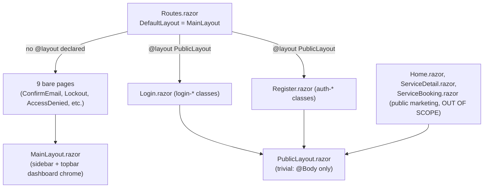
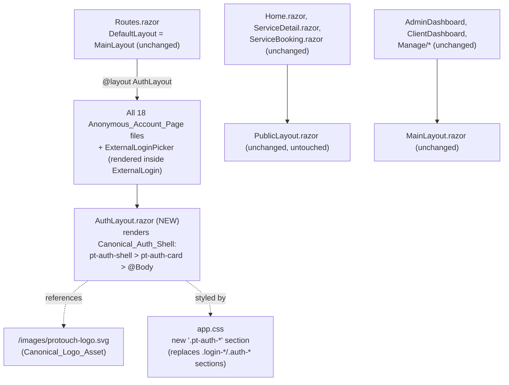

# Design Document: Account & Status Pages Consistency

## Overview

This feature unifies the visual presentation of every anonymous-flow account page in ClinicApp (`Login`, `Register`, and 16 related confirmation/error/verification pages) under a single branded shell and a single canonical set of presentational CSS classes, while leaving all ASP.NET Core Identity behavior (`@code` blocks, redirects, form bindings, cookie handling) untouched.

This is a **presentational/layout-only migration**, not a new algorithm or data-transformation feature. There is no new business logic, no new data model, and no parser/serializer. Accordingly:

- The "properties" in this design are **structural invariants over a finite, enumerable set of Razor/CSS source files** (the 18 in-scope pages plus `ExternalLoginPicker.razor`, `StatusMessage.razor`, and `PublicLayout.razor`), not properties over an infinite generated input space in the classic PBT sense — with one exception (`StatusMessage`'s error/success branch selection), which *does* vary meaningfully with input and is treated as a genuine input-driven property.
- Testing is example/static-assertion based (xUnit tests reading `.razor`/`.css` source, following the existing pattern already present in `ClinicApp.Tests/LayoutRegressionTests.cs`), plus one FsCheck-driven property test for the one genuinely input-varying property (StatusMessage variant selection), consistent with the `FsCheck`/`FsCheck.Xunit` packages already referenced in `ClinicApp.Tests.csproj`.

## Architecture

### Current State (confirmed by direct inspection)



Two problems fall out of this: (1) 9 pages render inside the authenticated dashboard shell despite being reachable while unauthenticated, and (2) `Login`/`Register` use two unrelated, one-off class systems with two different logo assets, while everything else has zero styling.

### Target State

**Decision: introduce a new, dedicated `AuthLayout.razor`, do not repurpose `PublicLayout.razor`.**

`PublicLayout.razor` is currently used by `Home.razor`, `ServiceDetail.razor`, and `ServiceBooking.razor` — the public marketing site, which is explicitly out of scope (Requirement 6.5). If `PublicLayout` were extended with conditional auth-shell markup, every future change to the auth shell would risk collateral regressions on the marketing pages, and vice versa. Introducing `Components/Layout/AuthLayout.razor` as a sibling to `PublicLayout.razor` and `MainLayout.razor` cleanly separates the three rendering contexts (dashboard / marketing / auth) with zero shared markup, at the cost of one small new file. `PublicLayout.razor` itself is left completely untouched — Requirement 6.4 ("apply Requirement 1 and 4 to `PublicLayout.razor`") is satisfied vacuously, since after this change `PublicLayout` no longer hosts any `Anonymous_Account_Page` and has no heading/logo/layout obligations of its own left to violate.



`AuthLayout.razor` is intentionally minimal — it inherits `LayoutComponentBase`, renders the `pt-auth-shell` wrapper with the `Canonical_Logo_Asset`, and renders `@Body` inside a `pt-auth-card`. `Login.razor`'s existing split-panel visual design (form panel + ambient decorative panel) is preserved as *page-level* markup inside `@Body` (not hoisted into the shared layout), because Requirement 4.4 permits a page-specific secondary decorative logo use, and because only `Login.razor` needs the two-column treatment — every other page uses the single-card treatment the shell itself provides.

### Why not reuse `PublicLayout.razor`

Rejected alternative: add an `AuthMode` parameter or conditional markup block to `PublicLayout.razor` so it can render either the marketing chrome or the auth shell. Rejected because:
1. It couples two unrelated, independently-evolving concerns (marketing site chrome vs. auth shell) in one file.
2. It would require a runtime/route-based conditional inside the layout, which is more fragile than Blazor's native per-page `@layout` directive.
3. Requirement 6.5 explicitly protects `Home.razor`/`ServiceDetail.razor`/`ServiceBooking.razor` from being touched by this feature; a shared, modified `PublicLayout.razor` is a larger blast radius against that requirement than a net-new file.

## Components and Interfaces

### Decision: Auth_UI_Library is a CSS class contract, not a set of new Razor wrapper components

The codebase has no existing precedent for small, composable presentational Razor components (an "atom" library). The one large shared layout component, `MainLayout.razor`, is a single monolithic file with inline markup styled entirely through CSS classes (`pt-topbar`, `pt-role-chip`, `user-badge`, `glass-panel`, etc.) — there is no `Button.razor` / `Card.razor` / `Input.razor` anywhere in `ClinicApp/Components`. The two existing shared *components* in the Account area, `StatusMessage.razor` and `ExternalLoginPicker.razor`, both carry real Identity logic (cookie reads, external scheme enumeration) — they are not presentational atoms, and this design does not touch their `@code` blocks.

Given that constraint, and Requirement 5.7 (a page's `@code` block must not have its method signatures, redirects, or Identity API calls altered), wrapping every `<input>`/`<button>`/`<label>` across 18 already-working pages in brand-new Razor components would force a much larger, riskier rewrite of markup structure across every page simultaneously, for no behavioral benefit. Defining the **Auth_UI_Library as a fixed set of canonical CSS classes** applied directly to the existing HTML/Blazor built-in elements (`InputText`, `EditForm`, `button`, `a`, `label`) satisfies Requirement 2 (one reusable element per concept) with a change that is purely additive at the CSS layer and purely substitutive (old class name → new class name) at the markup layer — the lowest-risk path consistent with this codebase's conventions.

### Auth_UI_Library — canonical class contract

| Concept (Requirement 2.1) | Canonical class | Applied to |
|---|---|---|
| Logo | `.pt-auth-logo` | `` inside the shell / `Login.razor`'s decorative panel |
| Page heading | `.pt-auth-heading` (on an `<h1>`) | every in-scope page's top-level heading |
| Card/panel container | `.pt-auth-card` (rendered by `AuthLayout`) | shell wrapper around every page's `@Body` |
| Text input | `.pt-auth-input` | every `InputText`/`InputCheckbox` on every in-scope page |
| Primary submit button | `.pt-auth-button` | every submit `<button>` on every in-scope page |
| Alert/status banner | `.pt-auth-alert` + `.pt-auth-alert--success` / `.pt-auth-alert--error` / `.pt-auth-alert--info` | `StatusMessage.razor`, `ExternalLogin.razor`'s info banner, confirmation pages' `role="alert"` paragraphs |
| Field validation message | `.pt-auth-field-error` | every `ValidationMessage`/`ValidationSummary` on every in-scope page |
| Footer link | `.pt-auth-link` | "Sign in" / "Back to website" / "click here to log in" style links |

This directly retires the two divergent legacy families (`login-*`, `auth-*`) called out in Requirement 2.2/2.3, and gives every currently-bare page (the 9 pages with no styling at all) the same primitives for free once they're wrapped by `AuthLayout`.

### `AuthLayout.razor` (new file)

```razor
@inherits LayoutComponentBase

<div class="pt-auth-shell">
    <div class="pt-auth-card">
        <div class="pt-auth-brand">
            
        </div>
        @Body
    </div>
</div>
```

Every in-scope page adds/changes exactly one line: `@layout AuthLayout`. No other structural component is introduced.

### Canonical_Logo_Asset decision

Two logo files are currently referenced: `/images/WhatsApp Image 2026-08-12 at 12.25.21 AM.jpeg` (used twice in `Login.razor`) and `/images/protouch-logo.svg` (used once in `Register.razor`). Direct inspection of `wwwroot/images/` confirms both files exist, plus two other unrelated logo variants (`sri-sai-protouch-logo.svg`, and the same jpeg is separately referenced by `MainLayout.razor`'s topbar — that usage is out of scope and untouched). **`protouch-logo.svg` is designated the Canonical_Logo_Asset.** SVG is vector-based and renders crisply at every size the shell needs (small brand mark, large card-header logo, `Login.razor`'s decorative panel logo) without the fixed-raster artifacting the `.jpeg` would show when scaled, and it has no filename-encoding hazard (the jpeg's filename contains spaces and requires URL-encoding, `WhatsApp%20Image...`, which is already a source of fragility elsewhere in this codebase per the `LayoutRegressionTests.cs` regression tests guarding that exact encoded string). `AuthLayout.razor` and every in-scope page reference only `/images/protouch-logo.svg`; no in-scope file references the `.jpeg` path after this change.

### CSS placement decision

This codebase's established convention (confirmed in `app.css` itself, and followed by every prior spec touching styling — `mobile-ui-fixes`, `homepage-attraction-redesign`, `beautiful-ui-redesign`, `aesthetic-clinic-redesign`) is a **single shared `app.css`, organized into clearly delimited banner-commented sections**, not one stylesheet per page or feature. `app.css` already contains a section literally named `AUTH PAGES — Login & Register` (line ~1706) holding the legacy `.auth-*` rules. This design follows that convention: the legacy `.login-*` and `.auth-*` rule blocks in `app.css` are replaced by one new section, `CANONICAL AUTH UI LIBRARY (pt-auth-*)`, scoped entirely to the `.pt-auth-*` class prefix so it cannot collide with `.wellness-page`, `.dashboard-theme`, or any other existing scope. No new CSS file is introduced.

## Data Models

**No data model changes.** This feature does not add, remove, or modify any C# class, `DbContext` entity, `InputModel`, or Identity API call. Confirmed per-page: every in-scope page's `@code` block (`InputModel` shapes, `FormName` strings, redirect targets, `SignInManager`/`UserManager` calls) was read directly during design and requires zero signature changes — only the Razor markup (tag classes, the `@layout` directive, and heading tag names) changes. This satisfies Requirement 5.7 by construction: the migration is markup-only.

## Migration Plan — Full Page Inventory (Requirement 6)

| File | Before | After |
|---|---|---|
| `Login.razor` | `@layout PublicLayout`; `login-*` classes; jpeg logo ×2; `h1.login-heading` | `@layout AuthLayout`; `pt-auth-*` classes (form fields/button/alert/links use canonical classes; split-panel structure kept as page-local markup); svg logo ×2 (main + decorative panel, permitted secondary use per Req 4.4); `h1.pt-auth-heading` |
| `Register.razor` | `@layout PublicLayout`; `auth-*` classes; svg logo ×1 | `@layout AuthLayout`; `pt-auth-*` classes; logo now rendered once by the shell itself — page-level `` removed to avoid a duplicate (Req 4.4) |
| `ConfirmEmail.razor` | no `@layout`; bare `<h1>`; no card | `@layout AuthLayout`; `<h1 class="pt-auth-heading">`; wrapped by shell card automatically |
| `ConfirmEmailChange.razor` | no `@layout`; bare `<h1>` | `@layout AuthLayout`; `<h1 class="pt-auth-heading">` |
| `RegisterConfirmation.razor` | no `@layout`; bare `<h1>`; plain `<p role="alert">` | `@layout AuthLayout`; `<h1 class="pt-auth-heading">`; `<p class="pt-auth-alert pt-auth-alert--info" role="alert">` |
| `ForgotPassword.razor` | `@layout` none (default MainLayout); Bootstrap `form-control`/`text-danger`/`btn-primary` | `@layout AuthLayout`; `pt-auth-input`/`pt-auth-field-error`/`pt-auth-button` |
| `ForgotPasswordConfirmation.razor` | no `@layout`; bare `<h1>`; plain `<p role="alert">` | `@layout AuthLayout`; `pt-auth-heading`; `pt-auth-alert pt-auth-alert--success` |
| `ResetPassword.razor` | no `@layout`; Bootstrap classes | `@layout AuthLayout`; `pt-auth-*` classes |
| `ResetPasswordConfirmation.razor` | no `@layout`; bare `<h1>`; plain `<p role="alert">` | `@layout AuthLayout`; `pt-auth-heading`; `pt-auth-alert pt-auth-alert--success`; link becomes `pt-auth-link` |
| `InvalidPasswordReset.razor` | no `@layout`; bare `<h1>`; plain `<p role="alert">` | `@layout AuthLayout`; `pt-auth-heading`; `pt-auth-alert pt-auth-alert--error` |
| `InvalidUser.razor` | no `@layout`; **`<h3>`** heading | `@layout AuthLayout`; heading corrected to `<h1 class="pt-auth-heading">` (Req 4.2) |
| `Lockout.razor` | no `@layout`; `<h1 class="text-danger">`; `<p class="text-danger" role="alert">` | `@layout AuthLayout`; `<h1 class="pt-auth-heading">`; `pt-auth-alert pt-auth-alert--error` |
| `AccessDenied.razor` | no `@layout`; `<h1 class="text-danger">`; `<p class="text-danger">` | `@layout AuthLayout`; `<h1 class="pt-auth-heading">`; `pt-auth-alert pt-auth-alert--error` |
| `LoginWith2fa.razor` | no `@layout`; Bootstrap classes | `@layout AuthLayout`; `pt-auth-*` classes |
| `LoginWithRecoveryCode.razor` | no `@layout`; Bootstrap classes | `@layout AuthLayout`; `pt-auth-*` classes |
| `VerifyPhone.razor` | no `@layout`; **`<h3>`** heading; Bootstrap classes | `@layout AuthLayout`; heading corrected to `<h1 class="pt-auth-heading">`; `pt-auth-*` classes |
| `ResendEmailConfirmation.razor` | no `@layout`; Bootstrap classes | `@layout AuthLayout`; `pt-auth-*` classes |
| `ExternalLogin.razor` | no `@layout`; `<h1>` + `<h2>`; `alert alert-info` | `@layout AuthLayout`; single `<h1 class="pt-auth-heading">` (subheading demoted to `<p class="pt-auth-subheading">`); `pt-auth-alert pt-auth-alert--info` |
| `ExternalLoginPicker.razor` (shared component, rendered inside `Login.razor`/`ExternalLogin.razor`) | plain `<button class="btn btn-primary">` | `<button class="pt-auth-button">`; informational `<p>` becomes `pt-auth-alert pt-auth-alert--info` |
| `StatusMessage.razor` | `alert alert-@(danger/success)` | `pt-auth-alert pt-auth-alert--@(error/success)` (same `DisplayMessage.StartsWith("Error")` branch, only the class names change) |
| `PublicLayout.razor` | trivial `@Body`-only layout, used by marketing pages | **unchanged** — no longer used by any in-scope page |

## Correctness Properties

*A property is a characteristic or behavior that should hold true across all valid executions of a system-essentially, a formal statement about what the system should do. Properties serve as the bridge between human-readable specifications and machine-verifiable correctness guarantees.*

For this feature, most properties are universally quantified over the **finite, enumerable set of in-scope source files** rather than over an infinite generated-input space, because this is a static markup/CSS migration. One property (Property 4) is universally quantified over an infinite input space (arbitrary message strings) and is a genuine candidate for FsCheck-driven generation.

### Property 1: Canonical Layout Declaration

For any page in the `Anonymous_Account_Page` set (all 18 pages listed in Requirement 6.1), its source SHALL contain the literal directive `@layout AuthLayout`, and SHALL NOT contain any other `@layout` directive.

**Validates: Requirements 1.1, 1.3, 1.4, 6.1**

### Property 2: Legacy Class Family Elimination

For any page in the `Anonymous_Account_Page` set, its source SHALL NOT contain any CSS class token beginning with `login-` or `auth-` (the retired legacy families), other than the canonical `pt-auth-` prefix.

**Validates: Requirements 2.2, 2.3, 2.4**

### Property 3: Canonical Card Container Presence

For any page in the `Anonymous_Account_Page` set, rendering that page SHALL result in its content being nested inside an element carrying the `pt-auth-card` class (via `AuthLayout`), including every page that previously rendered with no container at all.

**Validates: Requirements 2.5**

### Property 4: Status Alert Variant Correctness

For any string value passed as `StatusMessage`'s `DisplayMessage` (via the `Message` parameter or the status cookie), the rendered alert SHALL carry the `pt-auth-alert--error` class if and only if the string starts with `"Error"`, and SHALL carry `pt-auth-alert--success` otherwise.

**Validates: Requirements 3.1, 3.2**

### Property 5: Inline Alert Canonical Styling

For any page in the `Anonymous_Account_Page` set that renders an inline alert or informational banner outside of `StatusMessage` (`ExternalLogin.razor`'s provider-info banner; the `role="alert"` paragraphs on `RegisterConfirmation`, `ForgotPasswordConfirmation`, `ResetPasswordConfirmation`, `InvalidPasswordReset`, `Lockout`, `AccessDenied`), that alert element SHALL carry a `pt-auth-alert` class (with the appropriate `--success`/`--error`/`--info` modifier) and SHALL NOT carry `alert-info`, `alert-danger`, `alert-success`, or `text-danger`.

**Validates: Requirements 3.3**

### Property 6: Canonical Field-Error Styling

For any page in the `Anonymous_Account_Page` set that renders a `ValidationMessage` or `ValidationSummary`, that element SHALL carry the `pt-auth-field-error` class and SHALL NOT carry `login-field-error`, `auth-field-error`, or `text-danger`.

**Validates: Requirements 3.5**

### Property 7: Single H1 Per Page

For any page in the `Anonymous_Account_Page` set that renders a top-level page heading, the page's rendered markup SHALL contain exactly one `<h1>` element, and SHALL contain zero `<h2>`/`<h3>` elements used as a page-level heading substitute (this corrects `InvalidUser.razor`'s `<h3>` and `VerifyPhone.razor`'s `<h3>`).

**Validates: Requirements 4.1, 4.2**

### Property 8: Canonical Logo Asset Reference

For any file among `AuthLayout.razor` and the `Anonymous_Account_Page` set that renders a clinic logo ``, its `src` attribute SHALL reference `/images/protouch-logo.svg`, and no file in that set SHALL reference `/images/WhatsApp Image 2026-08-12 at 12.25.21 AM.jpeg` (or its URL-encoded form).

**Validates: Requirements 4.3, 4.5**

### Property 9: Bounded Logo Cardinality

For any page in the `Anonymous_Account_Page` set, the Canonical_Logo_Asset SHALL be rendered exactly once, except `Login.razor`, which SHALL render it exactly twice (once in the shell/form panel, once in the documented decorative visual panel per Requirement 4.4).

**Validates: Requirements 4.4**

### Property 10: Out-of-Scope File Isolation

For any file in the explicitly out-of-scope set (`MainLayout.razor`, `NavMenu.razor`, `ManageLayout.razor`, every file under `Components/Account/Pages/Manage/`, `AdminDashboard.razor`, `ClientDashboard.razor`, `Home.razor`, `ServiceDetail.razor`, `ServiceBooking.razor`, and `PublicLayout.razor`), that file's source SHALL be byte-identical to its pre-feature content — in particular it SHALL NOT reference `AuthLayout` or any `pt-auth-*` class.

**Validates: Requirements 6.4, 6.5**

### Coverage Notes

- Requirement 1.5 (future-page policy) and 2.6 (general consistency principle) have no independent test: 1.5 is a statement about `Routes.razor`'s unchanged default (covered by Property 10 keeping `Routes.razor` untouched, implicitly — no property claims it changes), and 2.6 is fully implied once Properties 1–3 establish that every page uses the same canonical classes.
- Requirement 3.4 ("visually equivalent wherever applied") is subsumed by Property 5/6: if the same CSS class governs every instance and that class is defined exactly once in `app.css`, visual equivalence follows structurally.
- Requirements 5.1–5.7 (Identity behavior preservation) are deliberately **excluded** from the Correctness Properties section — they are regression/example checks against fixed literal strings and existing method calls (see Testing Strategy and Error Handling below), not universally-quantified properties over a meaningfully varying input space.
- Property 8 and Property 9 are kept separate rather than merged: Property 8 asserts *which* asset is referenced (a path-equality check), Property 9 asserts *how many times* it appears (a cardinality check with a named, bounded exception) — collapsing them would hide the `Login.razor` exception inside a property that reads as a universal "exactly once" rule.

## Error Handling

This feature changes markup and CSS only; it introduces no new error paths. The design's job is to guarantee it does not *break* existing error handling:

- **`IdentityRedirectManager` redirects**: every `RedirectManager.RedirectTo(...)` / `RedirectToWithStatus(...)` call site is left untouched — only the surrounding markup changes. Verified per-file during design (Login, Register, ForgotPassword, ResetPassword, ConfirmEmail, ConfirmEmailChange, RegisterConfirmation, LoginWith2fa, LoginWithRecoveryCode, VerifyPhone, ExternalLogin all keep their exact existing redirect target strings and query-parameter dictionaries).
- **Cookie-based `StatusMessage` delivery**: `StatusMessage.razor`'s `OnInitialized` (reading `IdentityRedirectManager.StatusCookieName` from `HttpContext.Request.Cookies` and deleting it) is untouched; only the `<div class="alert alert-@statusMessageClass">` line changes to `<div class="pt-auth-alert pt-auth-alert--@statusMessageClass">`. The `DisplayMessage.StartsWith("Error")` branch that computes `statusMessageClass` is untouched (this is what Property 4 verifies still holds).
- **`FormName` / `EditForm` bindings**: every `FormName="..."` literal (`login`, `register`, `forgot-password`, `reset-password`, `login-with-2fa`, `login-with-recovery-code`, `resend-email-confirmation`, `confirmation`) is preserved verbatim; only the `class` attributes on `InputText`/`ValidationMessage`/`ValidationSummary` change.
- **2FA / recovery-code / phone OTP / external login flows**: `SignInManager.TwoFactorAuthenticatorSignInAsync`, `TwoFactorRecoveryCodeSignInAsync`, `ClinicService.VerifyPhoneOtpAsync`/`GeneratePhoneOtpAsync`, and `SignInManager.ExternalLoginSignInAsync`/`GetExternalLoginInfoAsync` calls in `LoginWith2fa.razor`, `LoginWithRecoveryCode.razor`, `VerifyPhone.razor`, and `ExternalLogin.razor` are untouched; each page's `@code` block requires zero edits beyond what markup changes require (none, in these four files, since their markup changes are class-attribute-only).
- **404 handling in `ConfirmEmail.razor`/`RegisterConfirmation.razor`** (`HttpContext.Response.StatusCode = StatusCodes.Status404NotFound`): untouched; the resulting `statusMessage` string still flows through `StatusMessage` exactly as before, now rendered with the canonical alert class.

## Testing Strategy

**Dual approach, following this repository's existing convention** (`ClinicApp.Tests/LayoutRegressionTests.cs` already reads `.razor`/`.razor.css` source files by path and asserts `Assert.Contains`/`Assert.DoesNotContain` against literal strings — this design extends that exact pattern rather than introducing a new testing approach):

- **Static-assertion unit tests** (xUnit, one test class per concern) for every structural property (Properties 1, 2, 3, 5, 6, 7, 8, 9, 10): each test reads the relevant `.razor`/`.css` file(s) via `Path.Combine(AppContext.BaseDirectory, "../../../..", ...)` (the existing `SolutionRoot` pattern) and asserts presence/absence of literal directive/class/tag strings. Because the input space is a fixed, finite file set (not generated), these are implemented as example-based tests that each enumerate the full 18-page set in a single `[Theory]`/`[MemberData]` list — this gives every page individual traceability while avoiding 18 near-duplicate test methods.
- **One property-based test** for Property 4 (Status Alert Variant Correctness), using **FsCheck.Xunit** (already a dependency in `ClinicApp.Tests.csproj`, no new library needed), generating arbitrary non-null strings for `DisplayMessage` and asserting the error/success branch selection matches `StartsWith("Error")`, run for a minimum of 100 iterations, tagged:
  **Feature: account-status-pages-consistency, Property 4: Status Alert Variant Correctness**
- **Identity-behavior regression tests** (unit tests, not properties — per the exclusion explained in Property Reflection above): one test per Requirement 5 sub-clause asserting the exact literal `FormName` value, redirect target string, and Identity API method name are still present in each affected file's source, mirroring the existing `LogoReferenceTests`/`SidebarCssTests` pattern in `LayoutRegressionTests.cs`.
- **Out-of-scope isolation test** (Property 10): a single test asserting each excluded file's content hash (or a targeted `Assert.DoesNotContain("AuthLayout", ...)` / `Assert.DoesNotContain("pt-auth-", ...)`) is unaffected.

No bUnit component-rendering harness is introduced — it is not currently a dependency of `ClinicApp.Tests`, and static source-text assertions are sufficient to verify a markup/CSS-only migration without adding a new test framework dependency.
