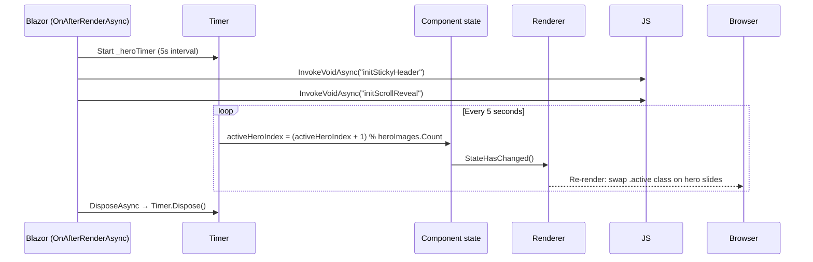
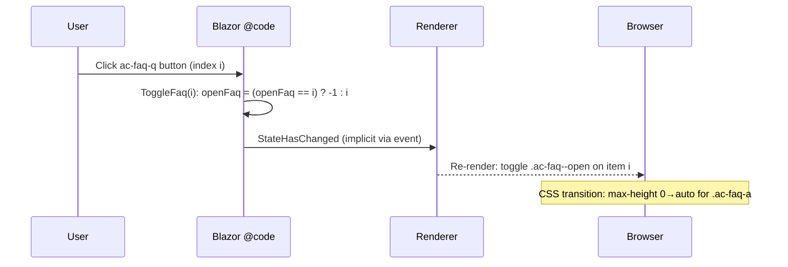

# Design Document: Aesthetic Clinic Redesign

## Overview

ProTouch Physio - Slimming Clinic's public-facing website will be redesigned from its current functional-but-simple layout into a luxury wellness brand experience inspired by the Aesthetic Clinic Wix template. The redesign introduces a dark/light split hero, a "Meet the Expert" doctor credibility section, a before/after treatment gallery, testimonial carousel, FAQ accordion, and a persistent WhatsApp/Book floating CTA — all while preserving the existing Blazor Server architecture, brand colours (green `#008d36`, purple `#7c1b68`, yellow `#ffeb00`, red `#e52321`), and the unchanged booking/service flows in `ServiceDetail.razor` and `ServiceBooking.razor`.

The redesign affects three files: `Home.razor` (new sections and component markup), `app.css` (new design tokens and scoped styles for every new section), and `site.js` (new JS functions for the before/after slider, FAQ accordion, testimonial carousel, and floating social buttons). `PublicLayout.razor` requires no changes because it is already a passthrough shell (`@Body` only).

---

## Architecture

```mermaid
graph TD
    subgraph "Blazor Server – Public Pages"
        A[PublicLayout.razor<br>passthrough – unchanged] --> B[Home.razor<br>ALL new sections]
        A --> C[ServiceDetail.razor<br>unchanged]
        A --> D[ServiceBooking.razor<br>unchanged]
    end

    subgraph "Static Assets"
        E[app.css<br>new design tokens + section styles]
        F[site.js<br>new JS functions]
        G[/images/clinic-gallery/<br>gallery-01..60.jpeg]
    end

    subgraph "Backend – unchanged"
        H[ClinicService.cs]
        I[BookingRequest model]
    end

    B -->|IJSRuntime interop| F
    B --> E
    B --> G
    C --> H
    D --> H
    H --> I
```

---

## Page Section Architecture — New Home.razor

```mermaid
graph TD
    P[ac-page wrapper] --> S1[1. ac-header — Sticky transparent→solid nav]
    P --> S2[2. ac-hero — Dark/light split with headline + hero carousel]
    P --> S3[3. ac-ticker — Guarantee strip animated ticker]
    P --> S4[4. ac-services — Tabbed services showcase]
    P --> S5[5. ac-doctor — Meet the Expert split panel]
    P --> S6[6. ac-stats — Animated counter strip]
    P --> S7[7. ac-before-after — Before/After comparison slider]
    P --> S8[8. ac-testimonials — Testimonial carousel]
    P --> S9[9. ac-faq — FAQ accordion]
    P --> S10[10. ac-contact — Contact + WhatsApp CTA]
    P --> S11[11. ac-footer — Footer]
    P --> S12[12. ac-floating-cta — Persistent floating WhatsApp + Book buttons]
```

The redesigned homepage is composed of 11 discrete sections rendered top-to-bottom inside a single `<div class="ac-page">` wrapper. Each section maps to one or more CSS class groups and, where interactive, to one JS function.



---

## Components and Interfaces

### Component 1: `ac-header` — Sticky Navigation

**Purpose**: Provides site-wide navigation that transitions from transparent-over-hero to a solid white bar on scroll.

**Markup interface** (within `Home.razor`):
```html
<header class="ac-header" id="ac-header">
  <a href="#top" class="ac-logo">…logo img…</a>
  <nav class="ac-nav">
    <a href="#services">Services</a>
    <a href="#doctor">About</a>
    <a href="#gallery">Gallery</a>
    <a href="#contact">Contact</a>
  </nav>
  <div class="ac-header-actions">
    <a href="/Account/Login" class="ac-login-btn">Login</a>
    <a href="tel:9673530031" class="ac-call-btn">📞 Call Now</a>
  </div>
</header>
```

**JS interface** (`site.js`):
```javascript
window.initStickyHeader = function(headerSelector) → void
// Observes scroll; toggles .ac-header--scrolled when page scrolled > 80px
```

**CSS tokens used**: `--ac-white`, `--ac-green`, `--ac-purple`, `--ac-font-body`

---

### Component 2: `ac-hero` — Dark/Light Split Hero

**Purpose**: Full-viewport hero with a dark left panel (headline + CTAs) and a light right panel (rotating clinic photography carousel).

**Markup interface**:
```html
<section class="ac-hero" id="top">
  <div class="ac-hero-left">          <!-- dark panel: bg #1a1025 -->
    <p class="ac-kicker">…</p>
    <h1 class="ac-hero-h1">…</h1>
    <p class="ac-hero-sub">…</p>
    <div class="ac-hero-actions">
      <a class="ac-btn-primary" href="/book">Book Appointment →</a>
      <a class="ac-btn-ghost" href="https://wa.me/…">💬 WhatsApp</a>
    </div>
    <div class="ac-trust-row">…badges…</div>
  </div>
  <div class="ac-hero-right">         <!-- light panel: white/cream bg -->
    <!-- Blazor @foreach hero images with .active class toggling -->
    @for (var i = 0; i < heroImages.Count; i++) { … }
    <div class="ac-hero-badge">…Dr. Manjari card…</div>
  </div>
</section>
```

**Blazor `@code` state**:
```csharp
List<string> heroImages          // paths to gallery images
int activeHeroIndex              // current active slide (0-based)
System.Threading.Timer? _heroTimer  // 5-second auto-advance
```

---

### Component 3: `ac-services` — Tabbed Services Showcase

**Purpose**: Replaces the simple card grid with a rich tabbed interface. Each tab reveals a full-width content panel showing the service description, treatment bullets, outcomes, and a direct "Book" CTA.

**Markup interface**:
```html
<section class="ac-services" id="services">
  <div class="ac-services-tabs">
    @foreach (var svc in serviceCards) {
      <button class="ac-tab @(activeTab == svc.Id ? "ac-tab--active" : "")"
              @onclick="() => SetTab(svc.Id)">…</button>
    }
  </div>
  <div class="ac-services-panel">
    <!-- Renders content for activeTab -->
    <div class="ac-panel-left">…icon, name, description, bullets…</div>
    <div class="ac-panel-right">…feature image from gallery…</div>
  </div>
</section>
```

**Blazor `@code` state**:
```csharp
string activeTab = "weight-loss"    // default active service tab
void SetTab(string id)              // updates activeTab
```

---

### Component 4: `ac-doctor` — Meet the Expert

**Purpose**: A high-credibility split panel featuring Dr. Manjari's photo, qualifications, certifications, and a personal message. Builds patient trust before the booking CTA.

**Markup interface**:
```html
<section class="ac-doctor" id="doctor">
  <div class="ac-doctor-photo">
    
    <div class="ac-doctor-cred-badge">ISO 9001:2015</div>
  </div>
  <div class="ac-doctor-copy">
    <p class="ac-kicker">MEET THE EXPERT</p>
    <h2>Dr. Manjari</h2>
    <p class="ac-doctor-title">Physiotherapist &amp; Slimming Expert</p>
    <p class="ac-doctor-bio">…personal intro paragraph…</p>
    <ul class="ac-doctor-credentials">
      <li>…credential bullets…</li>
    </ul>
    <a class="ac-btn-primary" href="/book">Book a Consultation →</a>
  </div>
</section>
```

---

### Component 5: `ac-before-after` — Before/After Comparison Slider

**Purpose**: Showcases treatment results using a draggable divider that reveals "before" on the left and "after" on the right. Provides tangible evidence of outcomes.

**Markup interface**:
```html
<section class="ac-before-after" id="gallery">
  <p class="ac-kicker">TREATMENT RESULTS</p>
  <h2>Real results from real patients.</h2>
  <div class="ac-ba-grid">
    @foreach (var pair in beforeAfterPairs) {
      <div class="ac-ba-item" data-ba>
        <div class="ac-ba-before">
          
          <span class="ac-ba-label">Before</span>
        </div>
        <div class="ac-ba-after" style="width: 50%">
          
          <span class="ac-ba-label">After</span>
        </div>
        <div class="ac-ba-handle" aria-label="Drag to compare"></div>
      </div>
    }
  </div>
</section>
```

**Blazor `@code` state**:
```csharp
record BeforeAfterPair(string Before, string After, string Label)
List<BeforeAfterPair> beforeAfterPairs   // static pairs from gallery images
```

**JS interface**:
```javascript
window.initBeforeAfterSliders = function(selector) → void
// Makes each [data-ba] element draggable; updates .ac-ba-after width on pointermove
window.destroyBeforeAfterSliders = function() → void
```

---

### Component 6: `ac-testimonials` — Testimonial Carousel

**Purpose**: Cycling testimonials from satisfied patients, with auto-advance, dot navigation, and manual prev/next controls.

**Markup interface**:
```html
<section class="ac-testimonials">
  <div class="ac-testi-track">
    @for (var i = 0; i < testimonials.Count; i++) {
      <div class="ac-testi-slide @(i == activeTestiIndex ? "ac-testi--active" : "")">
        <div class="ac-stars">★★★★★</div>
        <p class="ac-testi-quote">@t.Quote</p>
        <footer class="ac-testi-footer">— @t.RoleLabel</footer>
      </div>
    }
  </div>
  <div class="ac-testi-dots">…dot buttons…</div>
  <div class="ac-testi-arrows">
    <button @onclick="PrevTesti">‹</button>
    <button @onclick="NextTesti">›</button>
  </div>
</section>
```

**Blazor `@code` state**:
```csharp
int activeTestiIndex = 0
System.Threading.Timer? _testiTimer     // 6-second auto-advance
void NextTesti() / void PrevTesti()
void JumpToTesti(int index)
```

---

### Component 7: `ac-faq` — FAQ Accordion

**Purpose**: Expandable FAQ that addresses common patient concerns (cost, safety, results timing, eligibility). Reduces booking friction by pre-answering objections.

**Markup interface**:
```html
<section class="ac-faq">
  <p class="ac-kicker">FREQUENTLY ASKED</p>
  <h2>Your questions, answered.</h2>
  <div class="ac-faq-list">
    @foreach (var (q, a, i) in faqItems.Select((x,i)=>(x.Q, x.A, i))) {
      <div class="ac-faq-item @(openFaq == i ? "ac-faq--open" : "")">
        <button class="ac-faq-q" type="button" @onclick="() => ToggleFaq(i)">
          @q <span class="ac-faq-icon">@(openFaq == i ? "−" : "+")</span>
        </button>
        <div class="ac-faq-a"><p>@a</p></div>
      </div>
    }
  </div>
</section>
```

**Blazor `@code` state**:
```csharp
record FaqItem(string Q, string A)
List<FaqItem> faqItems            // static FAQ content
int openFaq = -1                  // -1 = all closed; index = open item
void ToggleFaq(int index)         // closes if same, opens if different
```

---

### Component 8: `ac-floating-cta` — Floating Social Buttons

**Purpose**: Persistent WhatsApp and Book buttons fixed to the bottom-right corner of the viewport, always accessible but unobtrusive.

**Markup interface**:
```html
<div class="ac-floating-cta" role="complementary" aria-label="Quick actions">
  <a class="ac-float-btn ac-float-wa" href="https://wa.me/919028027888"
     target="_blank" rel="noopener" aria-label="WhatsApp us">💬</a>
  <a class="ac-float-btn ac-float-book" href="/book"
     aria-label="Book appointment">📅</a>
</div>
```

**CSS**: `position: fixed; bottom: 2rem; right: 2rem; display: flex; flex-direction: column; gap: 0.75rem; z-index: 999`

---

## Data Models

### Model 1: `ServiceCard` (already in `@code`)

```csharp
record ServiceCard(
    string Id,           // "weight-loss" | "physiotherapy" | "yoga" | "specialised"
    string Number,       // "01" – "04"
    string Icon,         // emoji
    string Name,         // display name
    string Summary,      // one-line description
    string[] Bullets,    // 2 highlight bullets
    string AccentColor,  // brand colour hex
    string IconBg        // rgba background for icon chip
)
```

### Model 2: `BeforeAfterPair` (new)

```csharp
record BeforeAfterPair(
    string Before,   // relative image path
    string After,    // relative image path
    string Label     // treatment label, e.g. "Weight Loss - 4 weeks"
)
```

### Model 3: `FaqItem` (new)

```csharp
record FaqItem(string Q, string A)
```

### Model 4: `Testimonial` (already in `@code`)

```csharp
record Testimonial(string Quote, string RoleLabel)
```

### Model 5: `StatCounter` (already in `@code`)

```csharp
record StatCounter(string CountDisplay, double CountTarget, string Label)
```

---

## Design Tokens (New CSS Custom Properties)

The redesign introduces a second design-token layer scoped to `.ac-page` to avoid conflicting with existing `.wellness-page` and admin styles. All admin dashboard rules remain 100% untouched.

```css
.ac-page {
    /* Typography */
    --ac-font-body:    'Outfit', sans-serif;
    --ac-font-serif:   'Playfair Display', Georgia, serif;

    /* Brand colours */
    --ac-green:        #008d36;
    --ac-green-dark:   #006428;
    --ac-purple:       #7c1b68;
    --ac-yellow:       #ffeb00;
    --ac-red:          #e52321;
    --ac-black:        #0f0a14;
    --ac-white:        #ffffff;
    --ac-cream:        #f5f0eb;
    --ac-dark-hero:    #1a1025;

    /* Text */
    --ac-text-light:   #f8f4f2;
    --ac-text-muted:   #8a7f8e;
    --ac-text-body:    #2f2732;

    /* Shadows & glows */
    --ac-shadow-card:  0 4px 24px rgba(0,0,0,0.10);
    --ac-shadow-pop:   0 12px 48px rgba(0,0,0,0.18);
    --ac-glow-green:   0 0 24px rgba(0,141,54,0.35);
    --ac-glow-purple:  0 0 24px rgba(124,27,104,0.35);

    /* Transitions */
    --ac-ease:         cubic-bezier(0.4, 0, 0.2, 1);
    --ac-transition:   all 0.3s var(--ac-ease);
}
```

---

## Sequence Diagrams

### Hero Auto-Carousel Lifecycle



### Before/After Slider Interaction

```mermaid
sequenceDiagram
    participant U as User (pointer)
    participant DOM as DOM element [data-ba]
    participant JS as site.js (initBeforeAfterSliders)

    JS->>DOM: addEventListener pointerdown on .ac-ba-handle
    U->>DOM: pointerdown on handle
    DOM->>JS: capturePointer; listen pointermove
    loop While dragging
        U->>DOM: pointermove (clientX)
        JS->>DOM: Compute pct = (clientX - rect.left) / rect.width
        JS->>DOM: .ac-ba-after.style.width = clamp(5%, pct*100%, 95%)
    end
    U->>DOM: pointerup
    DOM->>JS: releasePointer; stop listening
```

### FAQ Accordion Toggle



---

## Algorithmic Pseudocode

### Main Algorithm: Page Initialisation (OnAfterRenderAsync)

```pascal
PROCEDURE OnAfterRenderAsync(firstRender)
  INPUT: firstRender : boolean
  OUTPUT: void (side effects: start timers, call JS)

  IF firstRender = false THEN
    RETURN   // guard: only run once
  END IF

  // Start image carousel timers
  _heroTimer ← StartTimer(interval=5s, callback=AdvanceHeroSlide)
  _testiTimer ← StartTimer(interval=6s, callback=AdvanceTestiSlide)

  // Initialise JS animations
  AWAIT JS.InvokeAsync("initStickyHeader", "#ac-header")
  AWAIT JS.InvokeAsync("initScrollReveal")
  AWAIT JS.InvokeAsync("initGuaranteeTicker")
  AWAIT JS.InvokeAsync("initBeforeAfterSliders", "[data-ba]")

  RETURN
END PROCEDURE
```

**Preconditions:**
- `firstRender = true` on first call
- DOM is fully rendered when OnAfterRenderAsync fires
- JS functions are registered on `window.*` before invocation

**Postconditions:**
- `_heroTimer` and `_testiTimer` are running
- All JS observers are registered
- Page is interactive

---

### Algorithm: Before/After Slider (JavaScript)

```pascal
PROCEDURE initBeforeAfterSliders(selector)
  INPUT: selector : string  (CSS selector for [data-ba] containers)
  OUTPUT: void (side effects: event listeners registered)

  items ← QueryAll(selector)

  FOR EACH item IN items DO
    handle ← item.QuerySelector(".ac-ba-handle")
    afterLayer ← item.QuerySelector(".ac-ba-after")
    dragging ← false

    PROCEDURE onPointerDown(event)
      dragging ← true
      item.SetPointerCapture(event.pointerId)
    END PROCEDURE

    PROCEDURE onPointerMove(event)
      IF dragging = false THEN RETURN END IF
      rect ← item.GetBoundingClientRect()
      pct ← (event.clientX - rect.left) / rect.width
      pct ← CLAMP(pct, 0.05, 0.95)
      afterLayer.style.width ← (pct * 100) + "%"
      handle.style.left ← (pct * 100) + "%"
    END PROCEDURE

    PROCEDURE onPointerUp(event)
      dragging ← false
      item.ReleasePointerCapture(event.pointerId)
    END PROCEDURE

    handle.AddEventListener("pointerdown", onPointerDown)
    item.AddEventListener("pointermove", onPointerMove)
    item.AddEventListener("pointerup", onPointerUp)
  END FOR

  // Store cleanup refs
  window._baCleanup ← FUNCTION that removes all event listeners
END PROCEDURE
```

**Preconditions:**
- `selector` matches at least one DOM element with `.ac-ba-handle` and `.ac-ba-after` children
- Pointer Events API is available (all modern browsers)

**Postconditions:**
- Each `[data-ba]` item responds to pointer drag
- `afterLayer.style.width` stays in range [5%, 95%]
- `window._baCleanup` is set for `DisposeAsync` cleanup

**Loop Invariants:**
- `pct` is always clamped to [0.05, 0.95] per iteration
- Each item registers exactly one set of listeners per call

---

### Algorithm: FAQ Accordion Toggle (Blazor @code)

```pascal
PROCEDURE ToggleFaq(index)
  INPUT: index : int  (index of clicked FAQ item, 0-based)
  OUTPUT: void (side effects: openFaq state mutated)

  PRECONDITION: 0 ≤ index < faqItems.Count

  IF openFaq = index THEN
    openFaq ← -1    // collapse: same item clicked again
  ELSE
    openFaq ← index // expand: new item clicked
  END IF

  POSTCONDITION: openFaq ∈ {-1} ∪ [0..faqItems.Count-1]
END PROCEDURE
```

**Preconditions:**
- `index` is within valid bounds
- `faqItems` list is non-null and populated

**Postconditions:**
- Exactly zero or one FAQ item is open at any time
- If the same item is clicked twice, it closes

---

### Algorithm: Testimonial Carousel Navigation

```pascal
PROCEDURE NextTesti()
  activeTestiIndex ← (activeTestiIndex + 1) MOD testimonials.Count
  // Reset timer to avoid double-advance
  _testiTimer?.Change(6000ms, 6000ms)
  StateHasChanged()
END PROCEDURE

PROCEDURE PrevTesti()
  activeTestiIndex ← (activeTestiIndex - 1 + testimonials.Count) MOD testimonials.Count
  _testiTimer?.Change(6000ms, 6000ms)
  StateHasChanged()
END PROCEDURE

PROCEDURE JumpToTesti(index)
  PRECONDITION: 0 ≤ index < testimonials.Count
  activeTestiIndex ← index
  _testiTimer?.Change(6000ms, 6000ms)
  StateHasChanged()
END PROCEDURE
```

**Loop Invariant**: `activeTestiIndex` always satisfies `0 ≤ activeTestiIndex < testimonials.Count`

---

## Key Functions with Formal Specifications

### `initStickyHeader(headerSelector)`

```javascript
function initStickyHeader(headerSelector: string): void
```

**Preconditions:**
- `document.querySelector(headerSelector)` returns a non-null element
- Called once during `OnAfterRenderAsync(firstRender=true)`

**Postconditions:**
- A scroll event listener is attached; when `window.scrollY > 80`, `.ac-header--scrolled` is added to the header element
- When `window.scrollY ≤ 80`, `.ac-header--scrolled` is removed
- The listener is stored as `window._stickyHeaderHandler` for disposal

---

### `initBeforeAfterSliders(selector)`

```javascript
function initBeforeAfterSliders(selector: string): void
```

**Preconditions:**
- Each element matching `selector` contains `.ac-ba-handle` and `.ac-ba-after` child elements
- Called only after DOM render is complete

**Postconditions:**
- All `[data-ba]` elements are interactive
- Pointer drag on `.ac-ba-handle` maps linearly to `afterLayer.style.width` in [5%, 95%]
- `window._baCleanup` is populated for `destroyBeforeAfterSliders()`

---

### `ToggleFaq(int index)` — Blazor

```csharp
void ToggleFaq(int index)
// Preconditions:  0 <= index < faqItems.Count
// Postconditions: openFaq == -1 || (0 <= openFaq < faqItems.Count)
//                 At most one FAQ item is open at any time
```

---

### `AdvanceHeroSlide()` / `AdvanceTestiSlide()` — Timer callbacks

```csharp
void AdvanceHeroSlide()
// Preconditions:  heroImages.Count > 0
// Postconditions: activeHeroIndex = (activeHeroIndex_pre + 1) % heroImages.Count

void AdvanceTestiSlide()
// Preconditions:  testimonials.Count > 0
// Postconditions: activeTestiIndex = (activeTestiIndex_pre + 1) % testimonials.Count
```

---

## Error Handling

### Scenario 1: Gallery Image 404

**Condition**: A `gallery-*.jpeg` path returns a 404 (missing image file)  
**Response**: All `` tags include `onerror="this.style.display='none'"` (consistent with existing `ServiceDetail.razor` pattern)  
**Recovery**: Adjacent images fill the layout; no JavaScript error is thrown

---

### Scenario 2: JS Function Not Available (slow load / script error)

**Condition**: Blazor calls `JS.InvokeVoidAsync("initBeforeAfterSliders", …)` but `site.js` has not yet loaded  
**Response**: All `InvokeVoidAsync` calls are wrapped in `try { … } catch { }` (consistent with existing pattern in `ServiceDetail.razor`)  
**Recovery**: Sliders render as static split images; no functionality is lost beyond interactivity

---

### Scenario 3: Timer Not Disposed

**Condition**: User navigates away from the homepage without `DisposeAsync` completing  
**Response**: `DisposeAsync` is declared via `@implements IAsyncDisposable`; it calls `_heroTimer?.Dispose()`, `_testiTimer?.Dispose()`, and `JS.InvokeVoidAsync("destroyAestheticAnimations")`  
**Recovery**: Blazor framework guarantees `DisposeAsync` is called on component disposal

---

### Scenario 4: Before/After on Touch Devices

**Condition**: User drags slider on a mobile touch screen  
**Response**: The JS slider uses `pointer events` (not `mouse events`), which handles both touch and mouse natively  
**Recovery**: Touch drag works identically to mouse drag; no separate touch handlers needed

---

## Testing Strategy

### Unit Testing Approach

Key logic to unit-test in isolation:

- `ToggleFaq(int index)` — verify open/close toggle and that `openFaq` is always in valid range
- `AdvanceHeroSlide()` — verify wrap-around at `heroImages.Count`
- `AdvanceTestiSlide()` — verify wrap-around at `testimonials.Count`
- `HandleSubmit()` in `ServiceBooking.razor` — unchanged, already covered by existing validation logic
- `PrevTesti()` — verify negative modulo wraps correctly in C#: `(0 - 1 + N) % N == N - 1`

### Property-Based Testing Approach

**Property Test Library**: xUnit + FsCheck (C# property testing)

Property tests for carousel index arithmetic and FAQ toggle guarantee correctness across all possible input combinations.

### Integration Testing Approach

- Playwright smoke tests: render homepage, confirm each new section (`ac-hero`, `ac-services`, `ac-doctor`, `ac-before-after`, `ac-testimonials`, `ac-faq`, `ac-contact`) is visible
- Before/after slider: simulate pointer drag and assert `.ac-ba-after` width changes
- FAQ: click each question and assert `.ac-faq--open` appears on the correct item

---

## Performance Considerations

- All non-hero gallery images use `loading="lazy"` to defer off-screen requests
- Hero images are `loading="eager"` with `fetchpriority="high"` on index 0 only (consistent with current pattern)
- Before/after slider uses CSS `will-change: width` on `.ac-ba-after` to GPU-promote the layer
- Testimonial and hero timers use `System.Threading.Timer` (not `PeriodicTimer`) to match existing pattern
- CSS animations respect `prefers-reduced-motion: reduce` — all timers and transitions are gated

---

## Security Considerations

- All external links (`wa.me`, Google Maps) carry `rel="noopener noreferrer"` and `target="_blank"`
- No new server endpoints are introduced; the redesign is entirely presentation-layer
- No user-submitted content is displayed without sanitisation (no new input fields on the homepage)
- The floating CTA links only to `/book` (internal) and `wa.me` (trusted WhatsApp URL)

---

## Dependencies

| Dependency | Source | Status |
|---|---|---|
| `Outfit` font | Google Fonts (already linked in `App.razor`) | Existing |
| `Playfair Display` font | Google Fonts (already linked in `App.razor`) | Existing |
| `app.css` | `/wwwroot/app.css` | Modified |
| `site.js` | `/wwwroot/site.js` | Modified (append only) |
| `Home.razor` | `Components/Pages/Home.razor` | Replaced |
| Gallery images | `/images/clinic-gallery/gallery-01..60.jpeg` | Existing |
| `ClinicService` | `Services/ClinicService.cs` | Unchanged |
| `BookingRequest` | `Data/BookingRequest.cs` | Unchanged |
| `PublicLayout.razor` | `Components/Layout/PublicLayout.razor` | Unchanged |

---

## Correctness Properties

*A property is a characteristic or behavior that should hold true across all valid executions of a system — essentially, a formal statement about what the system should do. Properties serve as the bridge between human-readable specifications and machine-verifiable correctness guarantees.*

### Property 1: Hero carousel index is always in bounds

*For any* number of hero images N > 0 and any number of timer ticks T ≥ 0, after T advances the `activeHeroIndex` satisfies `0 ≤ activeHeroIndex < N`.

**Validates: Requirements 3.3, 3.4**

### Property 2: Testimonial carousel index is always in bounds

*For any* list of testimonials of length N > 0, after any sequence of `NextTesti`, `PrevTesti`, or `JumpToTesti` calls, `activeTestiIndex` satisfies `0 ≤ activeTestiIndex < N`.

**Validates: Requirements 9.3, 9.4, 9.6**

### Property 3: FAQ accordion — at most one item open

*For any* FAQ list of length N ≥ 1 and any sequence of `ToggleFaq(i)` calls where `0 ≤ i < N`, `openFaq` is always either `-1` (all closed) or a valid index `0 ≤ openFaq < faqItems.Count`. Furthermore, clicking the same open index again always results in `openFaq = -1` (round-trip close).

**Validates: Requirements 10.2, 10.3, 10.4, 10.5**

### Property 4: Before/After slider width is always clamped

*For any* pointer drag position `clientX` and any slider container bounding rect, the resulting `.ac-ba-after` CSS width percentage is always in the inclusive range [5%, 95%] — including when `clientX` is to the left of the container, to the right of the container, or exactly on the edges.

**Validates: Requirements 8.3, 8.4**

### Property 5: Active tab is always a valid service ID

*For any* sequence of `SetTab(id)` calls where `id` is drawn from the set `{"weight-loss", "physiotherapy", "yoga", "specialised"}`, `activeTab` always equals the most recently set ID. The initial value `"weight-loss"` satisfies this invariant before any call is made.

**Validates: Requirements 5.2, 5.3, 5.6**

### Property 6: DisposeAsync suppresses all JS exceptions

*For any* JavaScript function invoked in `DisposeAsync` that throws an exception, the exception is caught and suppressed without propagating, ensuring `DisposeAsync` completes without error regardless of JS runtime state.

**Validates: Requirements 14.5**
