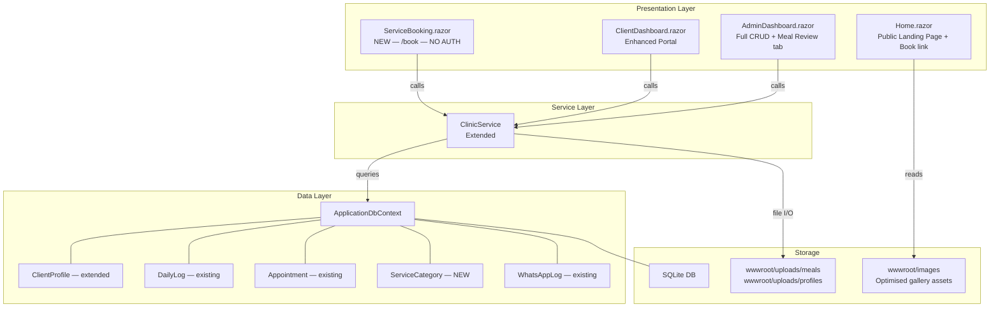
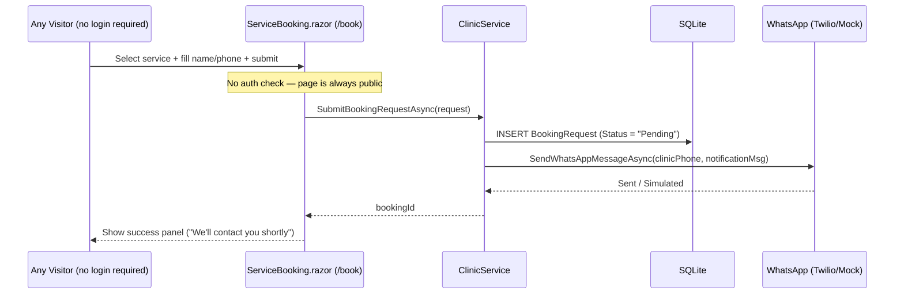

# Design Document: Clinic Website Enhancements

## Overview

This document describes the high-level design for a set of enhancements to the ProTouch Clinic Blazor Server application. The enhancements cover six concern areas: image asset management, complete admin CRUD operations, an improved client portal with meal photo review, WhatsApp bulk messaging via CSV, a dedicated service booking page, and strict adherence to the existing dark glass-morphism design system throughout.

The application already has a strong foundation — ASP.NET Core Identity with Admin/Client roles, EF Core + SQLite, a `ClinicService` that wraps all data and Twilio operations, and a cohesive CSS design system built on CSS custom properties. All enhancements are designed to extend, not replace, that foundation.

---

## Architecture

The overall structure remains a Blazor Server single-project application. No new services, databases, or external integrations are introduced beyond what already exists. Changes are concentrated in three layers: the data layer (one new model, two model extensions), the service layer (`ClinicService` extensions), and the presentation layer (new/updated Razor components).



---

## Components and Interfaces

### 1. Home.razor — Image Asset Refresh

**Purpose**: Replace WhatsApp-sourced raw filenames with semantically named, web-optimised images and fix duplicate `<section>` and `<PageTitle>` elements.

**Changes**:
- Rename gallery images to semantic slugs (e.g. `hero-treatment.jpg`, `care-panel.jpg`, `gallery-01.jpg … gallery-N.jpg`) and place them under `wwwroot/images/` and `wwwroot/images/clinic-gallery/`.
- Remove the duplicate `<PageTitle>` tag and the duplicate services `<section>`.
- Reference images via clean relative paths instead of raw WhatsApp export filenames.
- Add a photo gallery section to the landing page using the full clinic-gallery image set, displayed in a responsive CSS grid with `object-fit: cover` and the existing `glass-panel` overlay style.

**Interface** (no code changes to service or data layers):
```
/images/hero-treatment.jpg          → hero section main photo
/images/care-panel.jpg              → "Why ProTouch" section photo
/images/clinic-gallery/gallery-01…N → gallery grid
/images/sri-sai-protouch-logo.svg   → unchanged
```

---

### 2. AdminDashboard.razor — Complete CRUD

**Purpose**: Fill the gaps in admin client management so every entity can be fully created, read, updated, and deleted from the UI.

**New/Enhanced Tabs**:

| Tab | Current State | Target State |
|-----|---------------|-------------|
| Clients | View + partial edit (profile fields only) | Full edit: profile, measurements, role, active status + inline delete with confirmation |
| Add User | Exists | Add inline "Edit Existing" toggle to update user name, email, phone without re-creating |
| Visits | Log new visit only | Edit/delete existing visit records; set checkout time from UI |
| Appointments | Read-only in client card | New sub-tab: list all appointments, change status (Scheduled → Confirmed → Completed → Cancelled) |
| Meal Review | Does not exist | **New tab**: gallery of meal photos uploaded by clients, each card shows client name, date, diet notes, and macro breakdown |
| WhatsApp Center | CSV broadcast | Unchanged; already functional |

**Component Interface** (additions to `@code` block):
```csharp
// Visits
Task EditVisitAsync(AttendanceRecord record)
Task DeleteVisitAsync(int recordId)
Task CheckOutVisitAsync(int recordId)

// Appointments
List<Appointment> allAppointments
Task UpdateAppointmentStatusAsync(int id, string status)

// Meal Review
List<DailyLog> allMealLogs          // all logs where MealPhotoUrl is set
Task DeleteMealLogAsync(int logId)
```

**New `ClinicService` methods required**:
```csharp
Task DeleteAttendanceRecordAsync(int recordId)
Task UpdateAttendanceRecordAsync(AttendanceRecord record)
Task<List<DailyLog>> GetAllMealLogsAsync()   // includes User navigation
Task DeleteDailyLogAsync(int logId)
Task<List<Appointment>> GetAllAppointmentsAsync()  // already exists
```

---

### 3. ClientDashboard.razor — Enhanced Portal

**Purpose**: Improve the meal photo upload flow and provide a cleaner, more guided UI for daily diet and measurement input.

**Changes**:
- **Meal photo upload**: Add client-side image preview before submission; show previously uploaded meal photos in a timeline below the check-in form (thumbnail + date + diet notes + macro ring chart).
- **Macro input**: Replace raw `InputNumber` fields for macro percentages with an interactive slider group that enforces the rule `Carbs + Protein + Fat + Veg = 100`. Display a live pie/donut chart or colour-coded bar.
- **Measurement panel**: Expose WaistInches, ChestInches, HipsInches, ArmsInches as optional fields in the daily log form (mirrors the `DailyLog` model fields that already exist but are not surfaced in the form).
- **Diet notes**: Promote the diet notes textarea with labelled prompts (water intake, activity, meal descriptions) using placeholder guidance text.
- **Photo history tab**: Within the existing glass panel, add a toggle between "Log Entry" and "Photo History" views so clients can scroll through their meal photo timeline.

**New `ClinicService` method required**:
```csharp
Task UpdateDailyLogAsync(DailyLog log)   // for editing existing same-day log
```

---

### 4. WhatsApp Bulk Messaging — Policy-Compliant CSV Broadcast

**Purpose**: The CSV broadcast feature already exists in `WhatsAppCenter` tab but needs UX polish and policy guardrails.

**Changes**:
- **Template approval notice**: Display a persistent info banner explaining that WhatsApp Business API requires pre-approved message templates for outbound campaigns. Provide a link to the Twilio console.
- **Opt-out clause**: Automatically append an opt-out footer to all bulk messages: *"Reply STOP to unsubscribe."* (configurable via a `Setting` key `WhatsApp:OptOutFooter`).
- **Rate limiting indicator**: Show a progress bar during bulk dispatch with per-message delay (configurable via `Setting` key `WhatsApp:BulkDelayMs`, default 1000ms) to respect Twilio rate limits.
- **Dry-run mode**: Add a "Preview" button that renders the personalised message for each CSV row without sending, allowing admin to review before dispatch.
- **Delivery status column**: In the activity log table, expand `LogDetail` parsing to show per-recipient status badges (Delivered / Failed / Simulated).

**New `ClinicService` method required**:
```csharp
Task<List<CsvPreviewRow>> PreviewCsvCampaignAsync(string template, IEnumerable<CsvRecipient> recipients)
// Returns personalised message text per recipient without sending
```

**New model** (in-memory only, not persisted):
```csharp
public record CsvPreviewRow(string Name, string Phone, string PersonalisedMessage)
```

---

### 5. ServiceBooking.razor — Dedicated Booking Page

**Purpose**: A new **fully public** page at `/book` for any visitor — whether they have a clinic account or not — to browse services, choose a preferred time, and submit a booking request. On submission, a WhatsApp notification is dispatched to the clinic's configured number so staff can follow up.

**Route & Access**: `@page "/book"` — **no `[Authorize]` attribute**. This page is intentionally anonymous-access only. It does **not** check for a logged-in session, does **not** pre-fill any account data, and does **not** create an `Appointment` record (which is the authenticated-client model). All submissions go into `BookingRequest` regardless of whether the visitor happens to be logged in.

> **Design rationale**: The authenticated `Appointment` booking flow already exists inside `ClientDashboard.razor`. The `/book` page is the *public-facing* equivalent — for prospective patients, referrals, and walk-in enquiries who may not yet have (or need) a portal account.

**Sections**:

1. **Service Selection** — Cards for each service category (seeded static list, optionally DB-backed). Each card shows service name, duration estimate, and description. Selecting a card highlights it and populates the booking form.

2. **Booking Form** — Full name field, phone number field, preferred date/time picker, optional notes. All fields are always blank on load — no session data is read. No login prompt or redirect.

3. **Confirmation** — On submit, always creates a `BookingRequest` record with `Status = "Pending"`, then sends a WhatsApp notification to the clinic number. The page then shows a success confirmation panel with instructions for the visitor to await a call/WhatsApp reply from the clinic.

**New model** (`BookingRequest` — the only booking model used by this page):
```csharp
public class BookingRequest
{
    public int Id { get; set; }
    public string FullName { get; set; }
    public string PhoneNumber { get; set; }
    public string ServiceType { get; set; }
    public DateTime PreferredDate { get; set; }
    public string Notes { get; set; }
    public DateTime SubmittedAt { get; set; }
    public string Status { get; set; } = "Pending"; // Pending, Confirmed, Cancelled
}
```

**New `ClinicService` methods required**:
```csharp
Task<int> SubmitBookingRequestAsync(BookingRequest request)
Task<List<BookingRequest>> GetAllBookingRequestsAsync()
Task UpdateBookingRequestStatusAsync(int id, string status)
```

**WhatsApp notification on booking submission**:
```
Message to clinic:
"📅 New Booking Request
Name: {FullName}
Phone: {Phone}
Service: {ServiceType}
Preferred: {Date}
Notes: {Notes}"
```

**Admin view**: A new "Bookings" tab in `AdminDashboard` showing all `BookingRequest` records with status management (Pending → Confirmed → Cancelled), and a WhatsApp reply-to button for each.

**Component flow**:


---

### 6. Design Consistency

**Purpose**: Ensure all new UI components — the booking page, meal review tab, macro sliders, and admin booking management — match the existing dark glass-morphism design language.

**Design Token Reference** (all new components must use only these variables):

| Token | Usage |
|-------|-------|
| `--bg-glass` / `--border-glass` | All panels, cards, modals |
| `--accent-teal` / `--accent-blue` | Primary CTAs, active states, focus rings |
| `--accent-purple` | Secondary/alternative accent |
| `--accent-success` | Confirmed/paid/active status badges |
| `--accent-warning` | Pending/scheduled status badges |
| `--accent-danger` | Cancelled/error states, delete buttons |
| `--text-secondary` | Subtitles, metadata labels |
| `--grad-primary` | Gradient text headings (`gradient-text` class) |
| `glass-panel` class | All card containers |
| `btn-clinic` class | Primary action buttons |
| `btn-clinic-secondary` class | Secondary/ghost buttons |
| `btn-clinic-danger` class | Destructive actions |
| `soft-pill` class | Status badges |
| `clinic-label` / `clinic-input` classes | All form controls |
| `eyebrow` class | Section kicker labels |
| `section-heading` class | Panel title rows |

**New CSS additions** (to be appended to `app.css`):
- `.macro-slider-group` — flex container for the four macro sliders with live percentage labels
- `.macro-bar` — colour-coded horizontal bar showing macro split (Carbs = teal, Protein = blue, Fat = purple, Veg = success green)
- `.meal-timeline` — vertical list of meal photo cards with date spine
- `.service-card` — booking page service selection card (extends `glass-panel`, adds hover border-glow and selected state with `--accent-teal` border)
- `.booking-success` — full-width confirmation panel with animated checkmark using existing gradient colours
- `.gallery-grid` — responsive CSS grid for the Home page photo gallery (auto-fill, minmax 260px, gap 1rem)

---

## Data Models

### New: `BookingRequest`

```csharp
public class BookingRequest
{
    [Key]
    public int Id { get; set; }

    [Required]
    public string FullName { get; set; } = string.Empty;

    [Required]
    public string PhoneNumber { get; set; } = string.Empty;

    public string ServiceType { get; set; } = string.Empty;

    public DateTime PreferredDate { get; set; }

    public string Notes { get; set; } = string.Empty;

    public DateTime SubmittedAt { get; set; } = DateTime.UtcNow;

    public string Status { get; set; } = "Pending";
}
```

**Validation Rules**:
- `FullName`: Required, min 2 characters, max 100 characters
- `PhoneNumber`: Required, must match Indian phone pattern (10 digits, optionally prefixed with +91/91)
- `PreferredDate`: Must be at least 1 hour in the future
- `ServiceType`: Must be a non-empty string from the known service list

### Modified: `DailyLog` (no schema change)

All measurement fields (`WaistInches`, `ChestInches`, `HipsInches`, `ArmsInches`) already exist on the model but are not surfaced in the client form. No migration is needed — only UI changes.

### `ApplicationDbContext` additions

```csharp
public DbSet<BookingRequest> BookingRequests { get; set; }
```

A new EF Core migration (`AddBookingRequest`) is required.

---

## Error Handling

### File Upload Errors (meal photos, profile photos)
- **Condition**: File exceeds 8 MB, invalid extension, or write failure
- **Response**: Display inline `clinic-alert clinic-alert-danger` with descriptive message; do not block form submission for other fields
- **Recovery**: User can re-attempt upload; partial uploads are not persisted

### WhatsApp Send Failures
- **Condition**: Twilio API returns error; network timeout; missing credentials in live mode
- **Response**: Log failure to `WhatsAppLog` with `Status = "Failed"`; surface error count in the admin activity panel
- **Recovery**: Admin can retry individual failed recipients from the log detail view; mock mode always succeeds for dev

### Booking Submission Without Phone Confirmation
- **Condition**: A visitor on `/book` submits with an unverified phone number (no OTP step is required — the page is intentionally frictionless)
- **Response**: Accept the booking, save as `Status = "Pending"`, notify clinic via WhatsApp — clinic staff confirms by calling or WhatsApp-messaging the supplied number directly
- **Recovery**: Admin can update status from the Bookings tab and use the per-row WhatsApp reply button to confirm with the person

### Duplicate Daily Log
- **Condition**: Client submits a daily log for a date that already has a record
- **Response**: Upsert (update existing record) rather than insert a duplicate; show "Updated today's log" confirmation
- **Recovery**: N/A — the existing `LoadProfileDataAsync` logic already loads today's log into the form model; the service layer needs to detect and update rather than insert

### Admin Delete with Related Records
- **Condition**: Admin deletes a client who has `DailyLog`, `AttendanceRecord`, `Appointment`, or `PaymentNotification` records
- **Response**: Show a confirmation modal listing the count of related records; deletion cascades via EF Core (requires cascade delete configuration on FK relationships)
- **Recovery**: Deletion is permanent; admin must confirm before proceeding

---

## Testing Strategy

### Unit Testing Approach

Key service methods to unit test in isolation (using an in-memory SQLite context or mock DbContext):

- `SubmitBookingRequestAsync` — verify record is persisted with correct `Status = "Pending"` and `SubmittedAt` is UTC
- `PreviewCsvCampaignAsync` — verify personalisation substitution and opt-out footer appending without any Twilio calls
- `GetAllMealLogsAsync` — verify only logs with non-empty `MealPhotoUrl` are returned and `User` navigation property is included
- `UpdateDailyLogAsync` — verify upsert logic: same `UserId` + `LogDate` updates existing record rather than inserting

### Property-Based Testing Approach

**Property Test Library**: xUnit + FsCheck (F#-compatible QuickCheck for .NET)

Key properties:
- **Macro sum invariant**: For any submitted `DailyLog`, `CarbsPercentage + ProteinPercentage + FatPercentage + VegPercentage = 100`
- **Booking date future constraint**: For any `BookingRequest`, `PreferredDate > SubmittedAt`
- **Phone normalisation idempotency**: `NormalisePhone(NormalisePhone(x)) = NormalisePhone(x)` for the phone normalisation logic in `BuildWhatsAppLink`
- **CSV preview no side effects**: Running `PreviewCsvCampaignAsync` N times produces the same output and does not mutate `WhatsAppLog` count

### Integration Testing Approach

End-to-end flows to validate against the running app (Playwright or bUnit):

- Admin creates a `BookingRequest` directly and verifies it appears in the new Bookings tab
- Client submits a daily log with a meal photo, then admin navigates to Meal Review tab and sees the photo with correct metadata
- CSV campaign with 3 test recipients in mock mode: verify 3 `WhatsAppLog` entries are created with `Status = "Simulated"`

---

## Performance Considerations

- **Image assets**: All gallery JPEGs should be compressed to ≤ 200 KB each and served with `Cache-Control: max-age=31536000, immutable` via static file middleware. Consider converting to WebP format.
- **Meal photo storage**: Photos are stored on the filesystem under `wwwroot/uploads/`. For scale, this directory should be excluded from version control (already in `.gitignore`) and backed up separately. No change to the current approach is needed for the expected user count.
- **Bulk WhatsApp dispatch**: The configurable delay (`WhatsApp:BulkDelayMs`) prevents Twilio rate-limit errors. Default 1000ms permits ~60 messages/minute, sufficient for a small clinic.
- **Admin meal review tab**: `GetAllMealLogsAsync` should include pagination (page size 20) to avoid loading hundreds of base64/path records in one query.
- **Booking page**: Service categories are static or rarely-changing data; they can be seeded at startup and cached in-memory (via `IMemoryCache` or a static list in `ClinicService`) to avoid per-request DB hits.

---

## Security Considerations

- **File upload validation**: Both meal photo and profile photo upload handlers must enforce extension allowlist (`.jpg`, `.jpeg`, `.png`, `.webp`) and max size (8 MB) on the server side — not just client side.
- **Unauthenticated booking**: The `/book` page accepts submissions without authentication. Phone number is not verified at submission time. To prevent abuse, a server-side rate limiter (ASP.NET Core `RateLimiter` middleware) should be applied to the booking endpoint — max 5 submissions per IP per hour.
- **WhatsApp message content**: Admin-composed bulk message templates should be HTML-encoded before storage and display to prevent XSS in the log detail view.
- **Admin delete guard**: Deletion of client profiles (which triggers cascade deletion of all clinical records) must be protected by a confirmation step and scoped to the Admin role only (`[Authorize(Roles = "Admin")]` already in place).
- **CSRF**: All form submissions already use Blazor's server-side state management and `AntiforgeryToken` where applicable — no new exposure introduced.

---

## Dependencies

| Dependency | Purpose | Status |
|------------|---------|--------|
| Blazor Server (.NET 8+) | Rendering, interactivity | Existing |
| EF Core + SQLite | Data persistence | Existing — new migration needed for `BookingRequest` |
| ASP.NET Core Identity | Auth, roles | Existing |
| Twilio SDK | WhatsApp send (live + mock) | Existing |
| Bootstrap 5 | Layout utilities | Existing |
| `Outfit` Google Font | Typography | Existing |
| FsCheck / xUnit | Property-based + unit tests | **New** — for testing only, not a runtime dependency |
| `Microsoft.AspNetCore.RateLimiting` | Booking page abuse prevention | **New** — included in .NET 8 BCL, no NuGet required |
