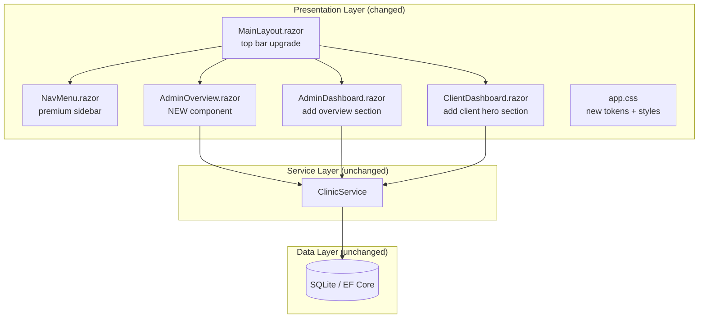
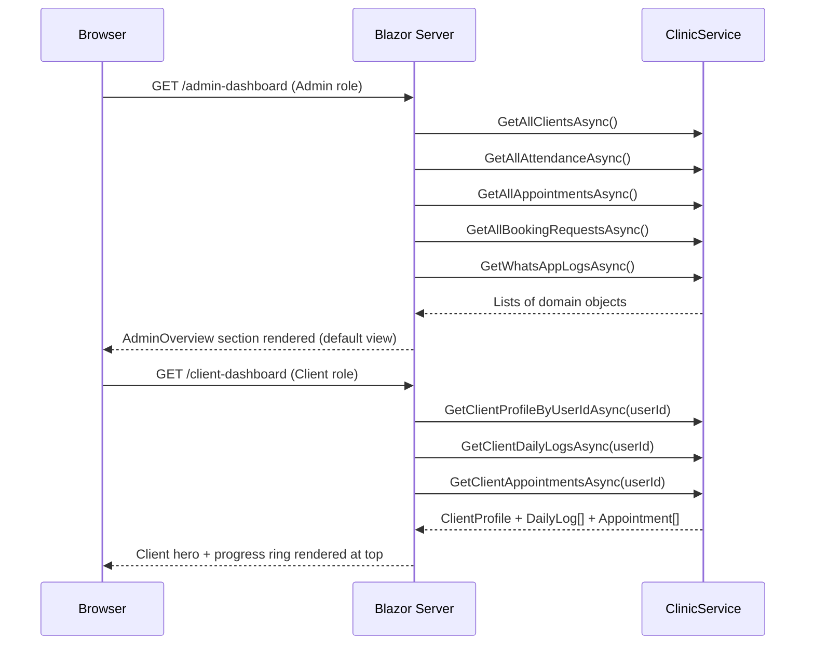
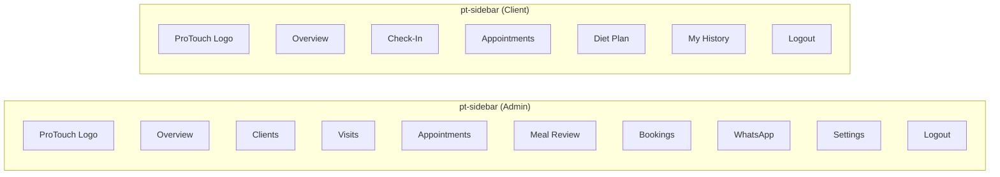
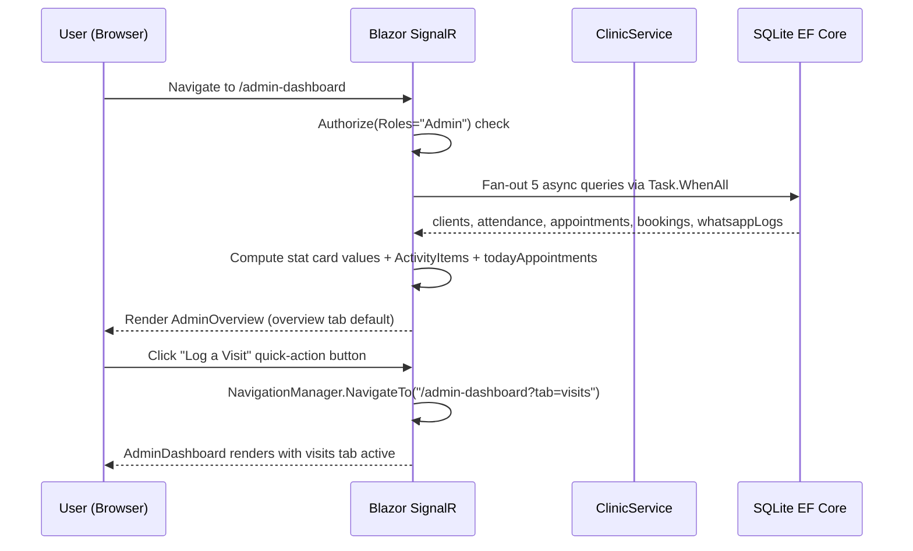

# Design Document: Dashboard Redesign

## Overview

This document specifies the premium dashboard redesign for **ProTouch Physio & Slimming Clinic**, a Blazor Server (.NET) application. The redesign replaces the bare Bootstrap sidebar and minimal stat cards with a premium clinic-grade UI — a branded collapsible sidebar (`NavMenu.razor`), an enhanced top bar (`MainLayout.razor`), a dedicated Admin Overview page (`AdminOverview.razor`), and a rich Client Overview hero section added to the top of `ClientDashboard.razor`. All styling lives under the `.dashboard-theme` scope in `app.css` with new CSS custom-property tokens, ensuring zero conflict with the existing `.wellness-page` and `.ac-page` public-site scopes. No new backend endpoints are required; all data is fetched through the existing `ClinicService` methods.

The design is inspired by modern healthcare portals (Wix Doctor's Practice and Healthcare & Doctors templates) and uses the brand palette — Green (#008d36), Purple (#7c1b68), Yellow (#ffeb00) — alongside the existing dark glassmorphism base. Typography uses **Outfit** for body text and **Playfair Display** for display headings.

---

## Part 1 — High-Level Design (Diagrams & Interfaces)

### Architecture

The redesign touches the **presentation layer only**. The existing three-tier structure (Database → ClinicService → Blazor components) remains unchanged.



### Page Flow



### Sidebar Navigation Structure



### Component Hierarchy

```mermaid
graph TD
    ML[MainLayout.razor]
    ML --> NM[NavMenu.razor<br/>.pt-sidebar]
    ML --> TB[Top Bar<br/>.pt-topbar]
    ML --> Body[@Body]
    Body --> AO[AdminOverview.razor<br/>default admin view]
    Body --> AD[AdminDashboard.razor<br/>tab panel]
    Body --> CD[ClientDashboard.razor]
    AO --> StatCards[5 Stat Cards<br/>.pt-stat-card]
    AO --> QuickActions[Quick Action Row<br/>.pt-quick-actions]
    AO --> ActivityFeed[Recent Activity Feed<br/>.pt-activity-feed]
    AO --> ApptStrip[Today's Appointments Strip<br/>.pt-appt-strip]
    CD --> ClientHero[Client Hero Section<br/>.pt-client-hero]
    ClientHero --> ProgressRing[SVG Progress Ring<br/>.pt-progress-ring]
    ClientHero --> StatPills[3 Quick-Stat Pills<br/>.pt-stat-pill]
    ClientHero --> NextAppt[Next Appointment Card<br/>.pt-next-appt]
    ClientHero --> CheckInPrompt[Daily Check-In Prompt<br/>.pt-checkin-prompt]
    ClientHero --> DietPreview[Diet Plan Preview<br/>.pt-diet-preview]
```

---

### Components and Interfaces

#### Component 1: NavMenu.razor — Premium Sidebar

**Purpose**: Provides branded, role-based navigation with collapse support for mobile.

**CSS class**: `.pt-sidebar`

**Interface contract**:
```csharp
// NavMenu.razor — injected services
@inject NavigationManager NavigationManager
// Role switching via AuthorizeView — no code-behind parameters required
```

**Responsibilities**:
- Render ProTouch logo (image + wordmark) at the top of the sidebar
- Render Admin nav section (8 items) when `AuthorizeView Roles="Admin"`
- Render Client nav section (5 items) when `AuthorizeView Roles="Client"`
- Apply `.active` state: green left border + green text + light-green background
- Pin Logout button at the bottom, separated by a `<hr>` line
- Collapse to icon-only (`--pt-sidebar-collapsed: 64px`) at ≤ 768 px with CSS `title` tooltip labels

**Visual states**:

| State | Width | Nav items | Logo |
|---|---|---|---|
| Expanded (≥ 769px) | `--pt-sidebar-width: 240px` | Icon + label | Full wordmark |
| Collapsed (≤ 768px) | `--pt-sidebar-collapsed: 64px` | Icon only + tooltip | Icon only |

---

#### Component 2: MainLayout.razor — Enhanced Top Bar

**Purpose**: Provides a branded top bar with clinic identity, role badge, and quick access to the public website.

**CSS class**: `.pt-topbar`

**Interface contract**:
```csharp
// MainLayout.razor receives @Body from the router
// No new parameters; reads AuthenticationState inline via AuthorizeView
```

**Responsibilities**:
- Left slot: ProTouch mini-logo (16×16 px brand mark)
- Centre slot: `"PROTOUCH Physio · Management Portal"` in Playfair Display
- Right slot: Visit Website button, role chip (`ADMIN`/`CLIENT`), username label
- Role chip colours: Admin → purple (#7c1b68), Client → green (#008d36)

---

#### Component 3: AdminOverview.razor — Admin Overview Page

**Purpose**: The default landing page for the Admin role at `/admin-dashboard`. Replaced the previous default "Clients" tab.

**Route**: `/admin-dashboard` (same as `AdminDashboard.razor`; the overview renders as the initial `activeTab == "overview"` section)

**Interface contract**:
```csharp
@rendermode InteractiveServer
@inject ClinicService ClinicService
@inject AuthenticationStateProvider AuthStateProvider

// Computed display properties (all derived from ClinicService calls)
private int activeClientsCount;         // clients.Count(c => c.IsActive)
private int todayVisitsCount;           // attendanceLogs filtered to IST today
private int pendingBookingsCount;       // bookings filtered to Status == "Pending"
private decimal pendingFeesTotal;       // sum of active PaymentNotification.Amount
private int whatsappSentCount;          // whatsappLogs.Count

// Activity feed — combined and sorted
private List<ActivityItem> recentActivity;   // last 5 visits + last 3 bookings
private List<Appointment> todayAppointments; // appointments for today (IST)
```

**Responsibilities**:
- Display a greeting bar with current IST date
- Render 5 stat cards with trend indicators (placeholder `↑`/`↓` vs yesterday)
- Render a Quick Actions row (4 buttons navigating to AdminDashboard tabs)
- Render a Recent Activity feed (unified timeline, 8 items max)
- Render a Today's Appointments horizontal strip

---

#### Component 4: ClientDashboard.razor — Client Hero Section

**Purpose**: A rich overview hero inserted at the top of `ClientDashboard.razor`, before the existing content.

**CSS class**: `.pt-client-hero`

**Interface contract**:
```csharp
// No new service methods; reads existing component state:
// userProfile      : ClientProfile
// dailyLogs        : List<DailyLog>
// latestWeight     : double
// hasLoggedWeightToday : bool
// appointments     : List<Appointment>

// Derived inside the hero block:
double kgLost       = userProfile.StartWeight - latestWeight;
double totalTarget  = userProfile.StartWeight - userProfile.TargetWeight;
int goalPct         = totalTarget > 0 ? (int)Math.Clamp(kgLost / totalTarget * 100, 0, 100) : 0;
Appointment? nextAppt = appointments.OrderBy(a => a.AppointmentDate)
                         .FirstOrDefault(a => a.AppointmentDate > DateTime.UtcNow &&
                                              a.Status != "Cancelled");
string dietPreview  = userProfile.DietPlan?.Length > 120
                         ? userProfile.DietPlan[..120] + "…"
                         : userProfile.DietPlan ?? "";
```

**Responsibilities**:
- Personalised greeting with time-of-day salutation and motivational sub-line
- SVG circular progress ring (kgLost / totalTarget * 100%) — green arc filled, grey remaining
- 3 quick-stat pills: Current Weight, Target Weight, Total Visits
- Next appointment card (or empty-state message)
- Daily check-in prompt: amber card if not logged today, green confirmation if already logged
- Diet plan preview with 120-character truncation and "View full plan →" anchor

---

### Data Models (relevant fields)

#### ClientProfile (existing)
```csharp
class ClientProfile {
    string UserId          // FK to ApplicationUser
    double StartWeight     // kg — used for progress ring baseline
    double TargetWeight    // kg — goal line on weight chart and stat pill
    double Height          // cm
    string DietPlan        // admin-composed nutrition plan (may be empty)
    bool   IsActive        // used in admin stat card count
    DateTime JoiningDate   // display in sidebar / hero
}
```

#### AttendanceRecord (existing)
```csharp
class AttendanceRecord {
    string   UserId
    DateTime CheckInTime   // used for today's visit count (IST date comparison)
    string   TreatmentReceived
    string   Therapist
    string   Status        // "Checked In" | "Completed" | "Absent"
    DateTime? NextAppointmentDate
}
```

#### Appointment (existing)
```csharp
class Appointment {
    string   UserId
    DateTime AppointmentDate  // UTC; convert to IST for display
    string   TreatmentType
    string   Status            // "Scheduled" | "Confirmed" | "Completed" | "Cancelled"
}
```

#### BookingRequest (existing)
```csharp
class BookingRequest {
    string   FullName
    string   PhoneNumber
    string   ServiceType
    DateTime PreferredDate
    string   Status        // "Pending" | "Confirmed" | "Cancelled"
    DateTime SubmittedAt
}
```

#### ActivityItem (new view-model — component-only)
```csharp
record ActivityItem(
    string Title,        // e.g. "Priya logged a visit" or "Booking: Raj (Physio)"
    string SubText,      // treatment type or booking service
    DateTime Timestamp,  // UTC; rendered as time-ago in component
    string Kind          // "visit" | "booking"
);
```

---

### Error Handling

#### Scenario 1: No data loaded (ClinicService throws / DB unavailable)
**Condition**: `OnInitializedAsync` catches an exception from ClinicService  
**Response**: Set an `errorMessage` string; render a `.clinic-alert.clinic-alert-danger` banner  
**Recovery**: Show a "Retry" button that calls `LoadAdminDataAsync()` again

#### Scenario 2: Client has no DietPlan assigned
**Condition**: `userProfile.DietPlan` is null or empty string  
**Response**: Render `"No plan assigned yet — contact your clinic."` in the diet preview card  
**Recovery**: N/A — expected state for new clients

#### Scenario 3: Client has no upcoming appointments
**Condition**: `nextAppt == null` after filtering  
**Response**: Render `"No upcoming appointments"` empty state with a "Book now →" anchor to the booking form  
**Recovery**: N/A

#### Scenario 4: Progress ring division by zero
**Condition**: `totalTarget ≤ 0` (StartWeight ≤ TargetWeight or both equal)  
**Response**: Clamp `goalPct = 0`; display ring at 0% with label "Goal not yet set"  
**Recovery**: Admin updates client profile

#### Scenario 5: Today's IST date comparison
**Condition**: Server is UTC; dates must be compared in IST  
**Response**: Use `ClinicService.IST` (pre-resolved `TimeZoneInfo`) for `TimeZoneInfo.ConvertTimeFromUtc` before `.Date` comparison  
**Recovery**: Unit-testable via `ClinicService.GetIst()`

---

### Testing Strategy

#### Unit Testing Approach

Focus on the pure computation helpers:
- `goalPct` clamping logic (0–100 bounds, division-by-zero guard)
- `dietPreview` truncation at exactly 120 characters
- `nextAppt` selection (first future, non-Cancelled appointment)
- `ActivityItem` list construction (ordering, item count limits)
- IST date conversion for "today's visits" and "today's appointments" counting

#### Property-Based Testing Approach

**Property Test Library**: `xUnit` + `FsCheck` (already in `ClinicApp.Tests`)

**Properties worth testing**:
1. For any `ClientProfile` where `StartWeight > TargetWeight`, `goalPct` is always in `[0, 100]`
2. For any string diet plan, the preview is always ≤ 120 characters (+ "…" suffix)
3. For any list of appointments, `nextAppt` is always either null or has `AppointmentDate > DateTime.UtcNow` and `Status != "Cancelled"`
4. For any list of attendance records, the "today count" equals the number of records whose IST date equals today's IST date

#### Integration Testing Approach

- Render `AdminOverview.razor` with a seeded in-memory EF Core DB (same pattern as `ClinicApp.Tests/PropertyTests.cs`)
- Assert all 5 stat card values match the seeded data
- Assert `recentActivity` list length ≤ 8

---

### Performance Considerations

- All data loads happen in a single `LoadAdminDataAsync()` fan-out of 5 parallel `Task.WhenAll` calls to avoid sequential DB round-trips
- The weight chart and progress ring use pure SVG with no JavaScript dependency
- The sidebar collapse uses CSS media queries only (no JS toggle) to keep initial render fast
- ActivityItems are capped at 8 to prevent long render loops on large clinics

---

### Security Considerations

- `AdminOverview.razor` uses `@attribute [Authorize(Roles = "Admin")]` — the route is protected at the Blazor middleware level
- `ClientDashboard.razor` hero section is scoped inside the existing `else` block that requires `userProfile != null`, so no new authentication surface is added
- No new parameters are passed via the URL; all data is loaded from the authenticated user's identity
- CSS scoping (`.dashboard-theme`) prevents any style bleed into `PublicLayout.razor` pages

---

### Dependencies

| Dependency | Purpose | Already present |
|---|---|---|
| `ClinicApp.Services.ClinicService` | All data retrieval | ✅ |
| `Microsoft.AspNetCore.Components.Authorization` | `AuthorizeView`, `AuthStateProvider` | ✅ |
| `Microsoft.AspNetCore.Identity.UserManager<ApplicationUser>` | Username / role lookup | ✅ |
| `Google Fonts: Outfit` | Body typography | ✅ (loaded in `index.html`) |
| `Google Fonts: Playfair Display` | Display headings in top bar | ⚠️ Must be added to `index.html` |
| `Bootstrap 5` | Layout utilities (grid, flex) | ✅ |
| No new NuGet packages required | | |

---

---

## Part 2 — Low-Level Design (Code-First)

### Overview

This section details the exact Blazor markup structure, CSS token definitions, C# code-behind patterns, and SVG geometry for each changed file. All code examples use **C# / Razor** (the framework in use). Pseudocode is not used; all snippets are implementation-ready.

---

### Main Algorithm / Workflow



---

### Core Interfaces / Types

```csharp
// ─── CSS Custom Properties (app.css) ────────────────────────────────────────
// :root additions under .dashboard-theme
/*
    --pt-sidebar-width:      240px;
    --pt-sidebar-collapsed:   64px;
    --pt-brand-green:        #008d36;
    --pt-brand-purple:       #7c1b68;
    --pt-brand-yellow:       #ffeb00;
    --pt-sidebar-bg:         #0d1117;
    --pt-sidebar-text:       #cbd5e1;
    --pt-sidebar-active-bg:  rgba(0, 141, 54, 0.12);
    --pt-sidebar-active-border: #008d36;
    --pt-topbar-height:      60px;
*/

// ─── View-model for Recent Activity feed ────────────────────────────────────
public record ActivityItem(
    string Title,
    string SubText,
    DateTime Timestamp,
    string Kind          // "visit" | "booking"
);

// ─── Stat card descriptor (passed to the shared card partial) ───────────────
public record StatCardModel(
    string Label,
    string Value,
    string Icon,
    string AccentColour,  // CSS hex string, e.g. "#008d36"
    string Trend          // "↑", "↓", or "—"
);
```

---

### Key Functions with Formal Specifications

#### Function 1: `BuildStatCards()` — AdminOverview.razor

```csharp
private List<StatCardModel> BuildStatCards()
```

**Preconditions:**
- `clients`, `attendanceLogs`, `pendingBookingsCount`, `pendingFeesTotal`, and `whatsappLogs` are all non-null (populated by `LoadAdminDataAsync`)
- `ClinicService.IST` timezone is resolvable (guaranteed by `ClinicService.GetIst()`)

**Postconditions:**
- Returns a `List<StatCardModel>` of exactly 5 items in the order: Active Clients, Today's Visits, Pending Bookings, Pending Fees, WhatsApp Sent
- `StatCardModel.Value` is always a non-null, non-empty string
- The "Today's Visits" value equals the count of `AttendanceRecord` where `ConvertTimeFromUtc(CheckInTime, IST).Date == ConvertTimeFromUtc(DateTime.UtcNow, IST).Date`

**Loop Invariants:** N/A (no loops — all counts are LINQ projections)

---

#### Function 2: `BuildActivityItems()` — AdminOverview.razor

```csharp
private List<ActivityItem> BuildActivityItems()
```

**Preconditions:**
- `attendanceLogs` is a non-null `List<AttendanceRecord>` (may be empty)
- `allBookings` is a non-null `List<BookingRequest>` (may be empty)

**Postconditions:**
- Returns at most 8 items
- Items are sorted descending by `Timestamp`
- All visit items have `Kind == "visit"`; all booking items have `Kind == "booking"`
- No item has a null `Title` or `SubText`

**Loop Invariants:** N/A (single LINQ concat + sort + take)

---

#### Function 3: `ComputeProgressRing(double startWeight, double latestWeight, double targetWeight)` — ClientDashboard.razor (inline computed)

```csharp
// Inline computation inside @code block; no separate method required
double kgLost      = startWeight - latestWeight;
double totalTarget = startWeight - targetWeight;
int    goalPct     = totalTarget > 0
                       ? (int)Math.Clamp(kgLost / totalTarget * 100.0, 0.0, 100.0)
                       : 0;

// SVG ring geometry — circumference of a circle with r=44
const double Radius      = 44.0;
const double Circumference = 2 * Math.PI * Radius;   // ≈ 276.46
double strokeDashoffset  = Circumference * (1 - goalPct / 100.0);
```

**Preconditions:**
- `startWeight` ≥ 0
- `latestWeight` ≥ 0
- `targetWeight` ≥ 0

**Postconditions:**
- `goalPct` is always in `[0, 100]`
- `strokeDashoffset` is in `[0, Circumference]`
- When `totalTarget ≤ 0`, `goalPct == 0` and no division occurs

**Loop Invariants:** N/A

---

#### Function 4: `GetDietPreview(string? dietPlan)` — ClientDashboard.razor

```csharp
private static string GetDietPreview(string? dietPlan)
```

**Preconditions:**
- `dietPlan` may be null, empty, or any length

**Postconditions:**
- Returns a string of at most 123 characters (`120 + "…"`)
- If `dietPlan` is null or whitespace, returns `""` (empty-state handled in markup)
- Does not mutate input

---

#### Function 5: `GetNextAppointment(List<Appointment> appointments)` — ClientDashboard.razor

```csharp
private static Appointment? GetNextAppointment(List<Appointment> appointments)
```

**Preconditions:**
- `appointments` is non-null (may be empty)

**Postconditions:**
- Returns the appointment with the earliest `AppointmentDate > DateTime.UtcNow` where `Status != "Cancelled"`, or `null` if none exists
- Does not modify `appointments`

---

### Algorithmic Pseudocode (C# / Razor)

#### Sidebar Nav Item Rendering — NavMenu.razor

```csharp
// Razor markup pattern for each nav item
// Used for all 8 admin items and 5 client items
@foreach (var item in adminNavItems)
{
    <li class="pt-nav-item">
        <NavLink class="pt-nav-link"
                 href="@item.Href"
                 Match="NavLinkMatch.Prefix"
                 ActiveClass="pt-nav-link--active">
            <span class="pt-nav-icon" aria-hidden="true">@item.Icon</span>
            <span class="pt-nav-label">@item.Label</span>
        </NavLink>
    </li>
}

// Nav item descriptor (component-scoped record)
record NavItem(string Href, string Icon, string Label);

private readonly NavItem[] adminNavItems =
{
    new("/admin-dashboard",                       "⊞",  "Overview"),
    new("/admin-dashboard?tab=clients",           "👥", "Clients"),
    new("/admin-dashboard?tab=visits",            "🏥", "Visits"),
    new("/admin-dashboard?tab=appointments",      "📋", "Appointments"),
    new("/admin-dashboard?tab=mealreview",        "🥗", "Meal Review"),
    new("/admin-dashboard?tab=bookings",          "📅", "Bookings"),
    new("/admin-dashboard?tab=whatsapp",          "💬", "WhatsApp"),
    new("/admin-dashboard?tab=settings",          "⚙️", "Settings"),
};

private readonly NavItem[] clientNavItems =
{
    new("/client-dashboard",                      "⊞",  "Overview"),
    new("/client-dashboard#checkin",              "✅", "Check-In"),
    new("/client-dashboard#appointments",         "📋", "Appointments"),
    new("/client-dashboard#diet",                 "🥗", "Diet Plan"),
    new("/client-dashboard#history",              "📈", "My History"),
};
```

**Preconditions:**
- `adminNavItems` and `clientNavItems` arrays are non-empty
- All `Href` values map to valid routes or anchor fragments

**Postconditions:**
- Each nav item renders exactly one `<li>` with a `<NavLink>` child
- `ActiveClass="pt-nav-link--active"` causes Blazor to apply the class when the current URL matches the href prefix

**Loop Invariants:**
- At each iteration, all previously rendered items are valid and unchanged

---

#### Admin Overview Data Load — AdminOverview.razor / AdminDashboard.razor

```csharp
private async Task LoadAdminDataAsync()
{
    // ASSERT: ClinicService is injected and non-null

    var (clientsResult, attendanceResult, appointmentsResult,
         bookingsResult, whatsappResult) = await (
         ClinicService.GetAllClientsAsync(),
         ClinicService.GetAllAttendanceAsync(),
         ClinicService.GetAllAppointmentsAsync(),
         ClinicService.GetAllBookingRequestsAsync(),
         ClinicService.GetWhatsAppLogsAsync()
    ).WhenAll5();   // helper or Task.WhenAll + destructuring

    clients        = clientsResult;
    attendanceLogs = attendanceResult;
    allAppointments = appointmentsResult;
    allBookings    = bookingsResult;
    whatsappLogs   = whatsappResult;

    // Compute derived counts
    var istNow = TimeZoneInfo.ConvertTimeFromUtc(DateTime.UtcNow, ClinicService.IST);
    todayAttendanceCount = attendanceLogs
        .Count(a => TimeZoneInfo.ConvertTimeFromUtc(a.CheckInTime, ClinicService.IST).Date
                    == istNow.Date);

    pendingBookingsCount = allBookings.Count(b => b.Status == "Pending");

    // Build activity + appointment strip
    recentActivity     = BuildActivityItems();
    todayAppointments  = allAppointments
        .Where(a => TimeZoneInfo.ConvertTimeFromUtc(a.AppointmentDate, ClinicService.IST).Date
                    == istNow.Date)
        .OrderBy(a => a.AppointmentDate)
        .ToList();

    // ASSERT: all derived collections are non-null
}
```

**Preconditions:**
- Component is in `InteractiveServer` render mode (SignalR circuit active)
- User has Admin role (enforced by `[Authorize(Roles = "Admin")]`)

**Postconditions:**
- `clients`, `attendanceLogs`, `allAppointments`, `allBookings`, `whatsappLogs` are all non-null
- `todayAttendanceCount ≥ 0`
- `pendingBookingsCount ≥ 0`
- `recentActivity.Count ≤ 8`
- `todayAppointments` is sorted ascending by `AppointmentDate`

**Loop Invariants:** N/A (no loops; LINQ projections)

---

#### SVG Progress Ring — ClientDashboard.razor

```razor
@{
    const double R = 44.0;
    const double C = 2 * Math.PI * R;   // ≈ 276.46
    double kgLost     = userProfile.StartWeight - latestWeight;
    double totalGoal  = userProfile.StartWeight - userProfile.TargetWeight;
    int    pct        = totalGoal > 0
                          ? (int)Math.Clamp(kgLost / totalGoal * 100.0, 0.0, 100.0)
                          : 0;
    double dashOffset = C * (1.0 - pct / 100.0);
}

<div class="pt-progress-ring" aria-label="Weight goal @pct% achieved">
    <svg viewBox="0 0 100 100" class="pt-ring-svg">
        <!-- Background grey ring -->
        <circle cx="50" cy="50" r="@R"
                fill="none"
                stroke="rgba(255,255,255,0.08)"
                stroke-width="8" />
        <!-- Green progress arc -->
        <circle cx="50" cy="50" r="@R"
                fill="none"
                stroke="var(--pt-brand-green)"
                stroke-width="8"
                stroke-linecap="round"
                stroke-dasharray="@C.ToString("F2")"
                stroke-dashoffset="@dashOffset.ToString("F2")"
                transform="rotate(-90 50 50)" />
        <!-- Centre label -->
        <text x="50" y="45" text-anchor="middle"
              fill="var(--text-primary)"
              font-size="14" font-weight="900"
              font-family="Outfit, sans-serif">
            @($"{kgLost:F1} kg")
        </text>
        <text x="50" y="60" text-anchor="middle"
              fill="var(--text-secondary)"
              font-size="8"
              font-family="Outfit, sans-serif">
            @pct% of goal
        </text>
    </svg>
</div>
```

**Preconditions:**
- `userProfile.StartWeight`, `userProfile.TargetWeight`, `latestWeight` are all non-negative doubles
- SVG `viewBox` is `0 0 100 100`; circle `cx=50 cy=50 r=44` fits within viewBox

**Postconditions:**
- `stroke-dashoffset` is always in `[0, C]` — ring never overflows or underflows
- `pct` text label matches the visual arc fill percentage

---

### CSS Token Definitions and Key Style Blocks

```css
/* ── New tokens added to :root inside .dashboard-theme ─────────────────── */
.dashboard-theme {
    --pt-sidebar-width:           240px;
    --pt-sidebar-collapsed:        64px;
    --pt-brand-green:            #008d36;
    --pt-brand-purple:           #7c1b68;
    --pt-brand-yellow:           #ffeb00;
    --pt-topbar-height:            60px;
    --pt-sidebar-bg:             #0d1117;
    --pt-sidebar-border:    rgba(255,255,255,0.06);
    --pt-sidebar-text:           #cbd5e1;
    --pt-sidebar-icon:           #94a3b8;
    --pt-sidebar-active-bg: rgba(0, 141, 54, 0.12);
    --pt-sidebar-active-border:  #008d36;
    --pt-sidebar-active-text:    #008d36;
    --pt-card-stat-size:           2.4rem;
    --pt-card-stat-weight:           900;
}

/* ── Sidebar layout ──────────────────────────────────────────────────────── */
.pt-sidebar {
    width: var(--pt-sidebar-width);
    min-height: 100vh;
    background: var(--pt-sidebar-bg);
    border-right: 1px solid var(--pt-sidebar-border);
    display: flex;
    flex-direction: column;
    position: fixed;
    top: 0; left: 0;
    z-index: 1000;
    transition: width 0.25s cubic-bezier(0.4, 0, 0.2, 1);
    overflow: hidden;
}

/* ── Nav link — default ──────────────────────────────────────────────────── */
.pt-nav-link {
    display: flex;
    align-items: center;
    gap: 12px;
    padding: 10px 16px;
    border-radius: 10px;
    margin: 2px 8px;
    color: var(--pt-sidebar-text);
    font-family: 'Outfit', sans-serif;
    font-size: 0.875rem;
    font-weight: 500;
    text-decoration: none;
    transition: background 0.18s ease, color 0.18s ease;
    white-space: nowrap;
    overflow: hidden;
}
.pt-nav-link:hover {
    background: rgba(255,255,255,0.04);
    color: var(--text-primary);
}

/* ── Nav link — active ──────────────────────────────────────────────────── */
.pt-nav-link--active {
    background: var(--pt-sidebar-active-bg) !important;
    color: var(--pt-sidebar-active-text) !important;
    border-left: 3px solid var(--pt-sidebar-active-border);
    padding-left: 13px; /* compensate for 3px border */
    font-weight: 700;
}

/* ── Stat card upgrade ───────────────────────────────────────────────────── */
.pt-stat-card {
    position: relative;
    padding: 24px;
    border-left: 4px solid var(--accent-colour, var(--pt-brand-green));
    transition: transform 0.2s ease, box-shadow 0.2s ease;
}
.pt-stat-card:hover {
    transform: translateY(-3px);
    box-shadow: 0 12px 36px rgba(0, 0, 0, 0.35);
}
.pt-stat-card .stat-number {
    font-size: var(--pt-card-stat-size);
    font-weight: var(--pt-card-stat-weight);
    line-height: 1;
    font-family: 'Outfit', sans-serif;
}
.pt-stat-card .stat-trend {
    font-size: 0.75rem;
    font-weight: 700;
    padding: 2px 6px;
    border-radius: 4px;
}
.pt-stat-card .stat-trend.up   { background: rgba(0,141,54,0.15); color: #008d36; }
.pt-stat-card .stat-trend.down { background: rgba(239,68,68,0.15); color: #ef4444; }

/* ── Collapsed sidebar ≤ 768px ──────────────────────────────────────────── */
@media (max-width: 768px) {
    .pt-sidebar {
        width: var(--pt-sidebar-collapsed);
    }
    .pt-nav-label,
    .pt-sidebar-wordmark,
    .pt-logout-label {
        display: none;
    }
    .pt-nav-link {
        justify-content: center;
        padding: 12px;
        margin: 2px 4px;
    }
    .pt-nav-link--active {
        border-left: none;
        border-bottom: 3px solid var(--pt-sidebar-active-border);
    }
}

/* ── Top bar ────────────────────────────────────────────────────────────── */
.pt-topbar {
    height: var(--pt-topbar-height);
    display: flex;
    align-items: center;
    justify-content: space-between;
    padding: 0 24px;
    background: rgba(13, 17, 23, 0.8);
    backdrop-filter: blur(12px);
    border-bottom: 1px solid var(--pt-sidebar-border);
    position: sticky;
    top: 0;
    z-index: 900;
}
.pt-topbar-title {
    font-family: 'Playfair Display', serif;
    font-size: 1rem;
    font-weight: 700;
    letter-spacing: 0.03em;
    color: var(--text-primary);
}
.pt-role-chip {
    font-size: 0.7rem;
    font-weight: 800;
    padding: 3px 10px;
    border-radius: 20px;
    letter-spacing: 0.08em;
    text-transform: uppercase;
}
.pt-role-chip.admin  { background: rgba(124, 27, 104, 0.2); color: #d48ec9; border: 1px solid rgba(124,27,104,0.4); }
.pt-role-chip.client { background: rgba(0, 141, 54, 0.2);  color: #4ade80; border: 1px solid rgba(0,141,54,0.4); }

/* ── Progress ring ─────────────────────────────────────────────────────── */
.pt-progress-ring {
    width: 120px;
    height: 120px;
    flex-shrink: 0;
}
.pt-ring-svg {
    width: 100%;
    height: 100%;
}

/* ── Stat pills ────────────────────────────────────────────────────────── */
.pt-stat-pill {
    display: inline-flex;
    flex-direction: column;
    align-items: center;
    background: rgba(255,255,255,0.04);
    border: 1px solid var(--border-glass);
    border-radius: 12px;
    padding: 12px 20px;
    min-width: 100px;
    gap: 4px;
}
.pt-stat-pill .pill-value {
    font-size: 1.2rem;
    font-weight: 800;
    color: var(--text-primary);
}
.pt-stat-pill .pill-label {
    font-size: 0.7rem;
    color: var(--text-secondary);
    text-transform: uppercase;
    letter-spacing: 0.06em;
}

/* ── Client hero ────────────────────────────────────────────────────────── */
.pt-client-hero {
    background: linear-gradient(135deg,
        rgba(0,141,54,0.08) 0%,
        rgba(13,17,23,0) 60%);
    border: 1px solid rgba(0,141,54,0.15);
    border-radius: 20px;
    padding: 32px;
    margin-bottom: 28px;
    display: flex;
    flex-wrap: wrap;
    gap: 28px;
    align-items: flex-start;
}

/* ── Check-in prompt ────────────────────────────────────────────────────── */
.pt-checkin-prompt {
    border-radius: 12px;
    padding: 14px 18px;
    display: flex;
    align-items: center;
    justify-content: space-between;
    gap: 12px;
}
.pt-checkin-prompt.needs-log {
    background: rgba(255, 235, 0, 0.08);
    border: 1px solid rgba(255,235,0,0.25);
}
.pt-checkin-prompt.logged {
    background: rgba(0, 141, 54, 0.08);
    border: 1px solid rgba(0,141,54,0.25);
}

/* ── Quick actions row ──────────────────────────────────────────────────── */
.pt-quick-actions {
    display: flex;
    flex-wrap: wrap;
    gap: 12px;
    margin-bottom: 28px;
}
.pt-quick-btn {
    display: inline-flex;
    align-items: center;
    gap: 8px;
    padding: 10px 18px;
    background: rgba(0,141,54,0.12);
    border: 1px solid rgba(0,141,54,0.3);
    border-radius: 10px;
    color: #4ade80;
    font-family: 'Outfit', sans-serif;
    font-size: 0.875rem;
    font-weight: 600;
    cursor: pointer;
    transition: background 0.18s ease, transform 0.15s ease;
}
.pt-quick-btn:hover {
    background: rgba(0,141,54,0.22);
    transform: translateY(-1px);
}

/* ── Activity feed ─────────────────────────────────────────────────────── */
.pt-activity-item {
    display: flex;
    align-items: flex-start;
    gap: 12px;
    padding: 10px 0;
    border-bottom: 1px solid var(--border-glass);
}
.pt-activity-item:last-child { border-bottom: none; }
.pt-activity-dot {
    width: 8px; height: 8px;
    border-radius: 50%;
    margin-top: 6px;
    flex-shrink: 0;
}
.pt-activity-dot.visit   { background: var(--pt-brand-green); }
.pt-activity-dot.booking { background: var(--pt-brand-purple); }

/* ── Appointment strip ──────────────────────────────────────────────────── */
.pt-appt-strip {
    display: flex;
    gap: 12px;
    overflow-x: auto;
    padding-bottom: 8px;
    scrollbar-width: thin;
}
.pt-appt-chip {
    flex-shrink: 0;
    background: rgba(255,255,255,0.04);
    border: 1px solid var(--border-glass);
    border-radius: 12px;
    padding: 10px 16px;
    min-width: 160px;
}
```

---

### Example Usage — AdminOverview.razor (key markup patterns)

```razor
@* ─── Greeting bar ──────────────────────────────────────────────────────── *@
<div class="d-flex justify-content-between align-items-center mb-4">
    <div>
        <p class="eyebrow mb-1">PROTOUCH PHYSIO — ADMIN OVERVIEW</p>
        <h1 class="gradient-text display-5 mb-0">
            @GetGreeting(), @adminName 👋
        </h1>
        <p class="text-secondary mb-0 small">
            @TimeZoneInfo.ConvertTimeFromUtc(DateTime.UtcNow, ClinicService.IST)
                         .ToString("dddd, dd MMMM yyyy")
        </p>
    </div>
    <button class="btn-clinic-secondary" @onclick="LoadAdminDataAsync">
        ↻ Refresh
    </button>
</div>

@* ─── 5 Stat cards ───────────────────────────────────────────────────────── *@
<div class="dashboard-grid mb-4">
    @foreach (var card in BuildStatCards())
    {
        <button class="glass-panel pt-stat-card text-start border-0"
                style="--accent-colour: @card.AccentColour"
                @onclick='() => NavigateToTab(card.TabTarget)'>
            <div>
                <span class="text-secondary small">@card.Label</span>
                <div class="stat-number">@card.Value</div>
                <span class="stat-trend @(card.Trend == "↑" ? "up" : card.Trend == "↓" ? "down" : "")">
                    @card.Trend
                </span>
            </div>
            <div class="stat-icon">@card.Icon</div>
        </button>
    }
</div>

@* ─── Quick actions row ──────────────────────────────────────────────────── *@
<div class="pt-quick-actions mb-4">
    <button class="pt-quick-btn" @onclick='() => NavigateToTab("clients")'>
        ＋ Add Client
    </button>
    <button class="pt-quick-btn" @onclick='() => NavigateToTab("visits")'>
        🏥 Log a Visit
    </button>
    <button class="pt-quick-btn" @onclick='() => NavigateToTab("bookings")'>
        📅 View Bookings
    </button>
    <button class="pt-quick-btn" @onclick='() => NavigateToTab("whatsapp")'>
        💬 Send WhatsApp
    </button>
</div>
```

---

### Correctness Properties

*A property is a characteristic or behaviour that should hold true across all valid executions of a system — essentially, a formal statement about what the system should do. Properties serve as the bridge between human-readable specifications and machine-verifiable correctness guarantees.*

---

### Property 1: Progress Ring Percentage Clamping

*For any* `ClientProfile` values `startWeight`, `latestWeight`, and `targetWeight` (all ≥ 0), the computed `goalPct` value is always an integer in the closed interval `[0, 100]`, and when `startWeight ≤ targetWeight`, `goalPct` is always `0`.

**Validates: Requirements to be mapped after requirements document is generated**

---

### Property 2: Diet Preview Truncation

*For any* diet plan string of any length (including null, empty, or very long strings), `GetDietPreview` returns a string whose length is always ≤ 123 characters (120 content chars + 3 for "…"), and the returned value is always a prefix of the original non-null input.

**Validates: Requirements to be mapped after requirements document is generated**

---

### Property 3: Next Appointment Selection

*For any* list of `Appointment` objects, `GetNextAppointment` returns either `null` or an appointment whose `AppointmentDate` is strictly greater than `DateTime.UtcNow` and whose `Status` is not `"Cancelled"`. No appointment with a past date or cancelled status is ever returned.

**Validates: Requirements to be mapped after requirements document is generated**

---

### Property 4: Activity Feed Size Invariant

*For any* combination of `attendanceLogs` (n visits) and `allBookings` (m bookings), `BuildActivityItems()` always returns a list of at most 8 items, and the returned items are sorted in descending order by `Timestamp`.

**Validates: Requirements to be mapped after requirements document is generated**

---

### Property 5: Today's Visit Count Accuracy

*For any* list of `AttendanceRecord` objects, the computed `todayAttendanceCount` equals the exact number of records whose `CheckInTime` (converted to IST) falls on today's IST date — no records from other days are counted, and no today's records are omitted.

**Validates: Requirements to be mapped after requirements document is generated**

---

### Property 6: Sidebar Active State Consistency

*For any* navigation URL, at most one nav item in the sidebar has the `pt-nav-link--active` class applied at any given time. The active item always corresponds to the longest matching URL prefix among all nav items.

**Validates: Requirements to be mapped after requirements document is generated**

---

### Property 7: Stat Cards Count Invariant

*For any* state of the admin data (any combination of clients, visits, bookings, fees, WhatsApp logs), `BuildStatCards()` always returns a list of exactly 5 `StatCardModel` items, none of which has a null or empty `Label` or `Value`.

**Validates: Requirements to be mapped after requirements document is generated**

---

### Property 8: CSS Scope Isolation

*For any* public-site page rendered under `.wellness-page` or `.ac-page`, none of the new `.pt-*` CSS classes or `--pt-*` custom properties apply, and no new selector from the dashboard redesign overrides or conflicts with the existing public-site styles.

**Validates: Requirements to be mapped after requirements document is generated**
