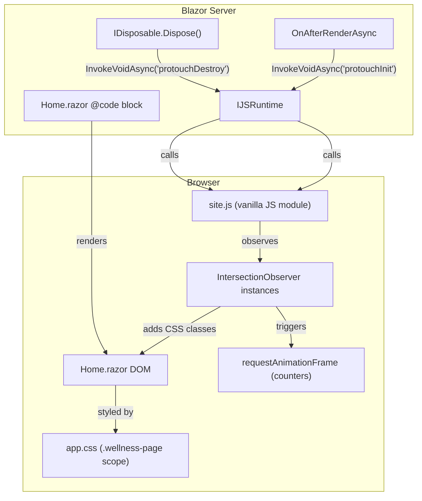
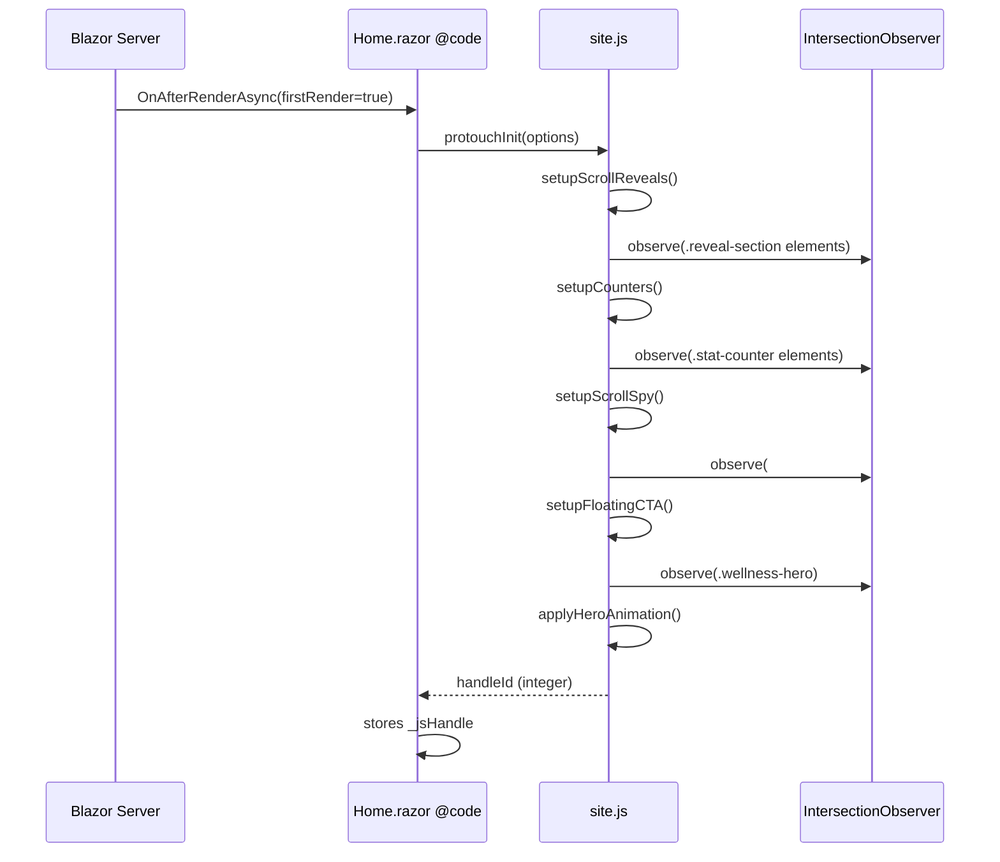
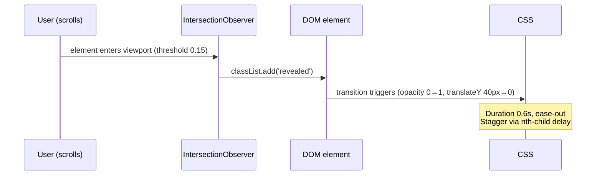
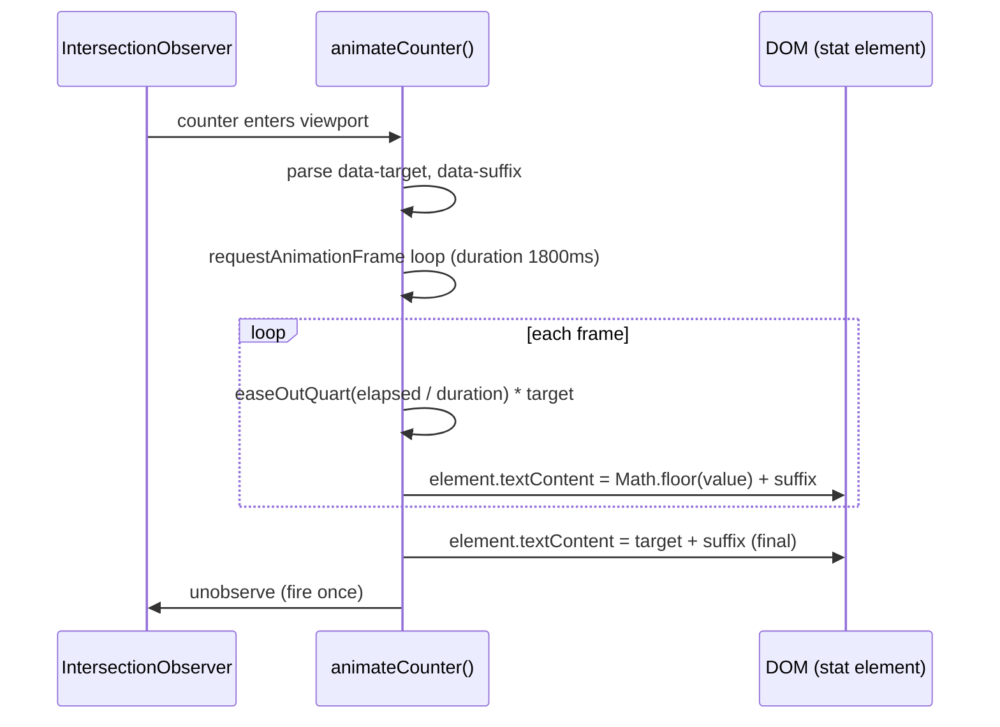

# Design Document: Homepage Dynamic Redesign

## Overview

The ProTouch Physio - Slimming Clinic homepage (`Home.razor`) is functionally complete but visually static. This feature adds eight coordinated dynamic enhancements — scroll-triggered reveals, animated counters, staggered hero text, service card micro-interactions, a guarantee strip ticker, a floating CTA button, a parallax-lite hero, and scroll-spy nav highlighting — to make the page feel like a premium wellness brand experience.

All enhancements are layered onto the **existing** Blazor Server (`@rendermode InteractiveServer`) page without introducing npm dependencies or breaking the two existing C# `Timer`-driven carousels. The primary implementation surface is a new `wwwroot/site.js` file (vanilla JavaScript) called via `IJSRuntime`, plus additive CSS inside the existing `.wellness-page` scope in `app.css`. Every animation respects the user's `prefers-reduced-motion` media preference.

---

## Architecture



**Key design decisions:**

- **Single JS entry point** — `window.protouchInit()` is the only function Blazor calls. It sets up all observers and returns a handle ID for teardown. `window.protouchDestroy(id)` disconnects everything on Dispose.
- **CSS-class-toggle model** — JavaScript never sets inline styles. It only adds/removes CSS classes (`.revealed`, `.counting`, `.nav-active`, `.float-cta-visible`). All visual changes are expressed in CSS.
- **No new Blazor components** — All eight features are implemented as CSS + JS enhancements to the single existing `Home.razor` page. The `@code` block grows modestly (one `OnAfterRenderAsync`, one `Dispose` call).
- **Additive CSS only** — No existing `.wellness-page` rules are modified; all new rules are appended at the end of `app.css`.

---

## Sequence Diagrams

### Initialization Flow



### Scroll Reveal — Individual Section



### Counter Animation



---

## Components and Interfaces

### 1. `site.js` — Public API

**Purpose**: Vanilla JS module that owns all eight animation subsystems. Exposed on `window` for Blazor JSInterop.

```typescript
// Conceptual interface — implemented as plain JS
interface ProtouchAnimations {
  protouchInit(options: InitOptions): number;   // returns handle ID
  protouchDestroy(handleId: number): void;
}

interface InitOptions {
  counterSelector:  string;   // default '.stat-counter'
  revealSelector:   string;   // default '.reveal-section'
  spySelector:      string;   // default '[data-section-id]'
  heroSelector:     string;   // default '.wellness-hero'
  ctaSelector:      string;   // default '.float-cta'
  reducedMotion:    boolean;  // passed from Blazor (@code reads window.matchMedia)
}
```

**Responsibilities:**
- `setupScrollReveals()` — Creates one `IntersectionObserver` watching `.reveal-section` elements; toggles `.revealed`
- `setupCounters()` — Creates one `IntersectionObserver` watching `.stat-counter` elements; fires `animateCounter()` once per element
- `setupScrollSpy()` — Creates one `IntersectionObserver` watching anchor sections; toggles `.nav-active` on matching `<a>` tags in `.wellness-header nav`
- `setupFloatingCTA()` — Creates one `IntersectionObserver` watching `.wellness-hero`; toggles `.float-cta-visible` on the floating button when hero leaves viewport
- `applyHeroAnimation()` — Adds `.hero-animate` to `.hero-content` immediately (triggers CSS stagger keyframes)
- `animateCounter(el, target, suffix, duration)` — `requestAnimationFrame` loop with `easeOutQuart` easing
- `protouchDestroy(id)` — Disconnects all observers stored under the given handle ID; cancels any pending `requestAnimationFrame` callbacks

### 2. Home.razor `@code` additions

**Purpose**: Blazor-side wiring — initialises the JS module after first render and tears it down on Dispose.

```csharp
interface IHomeDynamicBehavior {
  // Called once: firstRender == true
  Task OnAfterRenderAsync(bool firstRender);

  // Cleans up JS observers to prevent memory leaks
  void Dispose();
}
```

**New fields:**
```csharp
[Inject] IJSRuntime JS { get; set; }
private int _jsHandle = -1;
```

**Responsibilities:**
- Inject `IJSRuntime`
- In `OnAfterRenderAsync(firstRender=true)`: call `protouchInit` and store `_jsHandle`
- In `Dispose()`: if `_jsHandle >= 0`, call `protouchDestroy(_jsHandle)` before the existing timer disposals

### 3. CSS additions to `app.css` (`.wellness-page` scope)

**Purpose**: All visual state for every animation feature, expressed as CSS classes toggled by JS or triggered by CSS keyframes.

| CSS Class / Rule | Controlled by | Description |
|---|---|---|
| `.reveal-section` | Author (markup) | Initial hidden state: `opacity:0; transform:translateY(40px)` |
| `.reveal-section.revealed` | JS | Visible state: `opacity:1; transform:none; transition: 0.6s ease-out` |
| `.hero-content.hero-animate .hero-line` | JS (adds `.hero-animate`) | Stagger keyframe via `animation-delay: calc(var(--i) * 0.12s)` |
| `.stat-counter` | Author (markup) | Marks a number span as a counter target |
| `.float-cta` | Author (markup) | Sticky button, initially `opacity:0; pointer-events:none` |
| `.float-cta.float-cta-visible` | JS | `opacity:1; pointer-events:auto` + pulse keyframe |
| `.guarantee-strip` (desktop) | CSS | Highlight pulse: `@keyframes guaranteePulse` on each `span` with nth-child delay |
| `.guarantee-strip` (mobile) | CSS | Marquee: `@keyframes marquee` on a wrapper with `overflow:hidden` |
| `[data-section-id] nav a.nav-active` | JS | `border-bottom-color: #008d36; color: #008d36` underline indicator |
| `@media (prefers-reduced-motion: reduce)` | CSS | Disables all transitions, animations, and parallax |

---

## Data Models

### Stats Section Data

The animated counters require a structured data model embedded in the markup via `data-*` attributes.

```csharp
// Rendered inline in Home.razor — no backing C# class needed
// Markup pattern:
// <span class="stat-counter" data-target="500" data-suffix="+" data-prefix="">500+</span>

record StatItem(
    int    Target,      // numeric end value
    string Suffix,      // appended after number, e.g. "+"
    string Prefix,      // prepended before number, e.g. ""
    string Label        // descriptive text below the number
);

// Initial static values rendered as fallback text (no JS = still readable)
static readonly StatItem[] Stats = new[]
{
    new StatItem(500,  "+", "", "Happy Clients"),
    new StatItem(10,   "+", "", "Years of Expert Care"),
    new StatItem(8,    "+", "", "Kg Loss Per Month"),
    new StatItem(5,    "+", "", "Inch Loss Per Session"),
};
```

**Validation rules:**
- `Target` must be a positive integer
- `Suffix`/`Prefix` are optional strings (empty string is valid)
- `Label` must be non-empty
- Fallback text content equals `Prefix + Target + Suffix` (rendered server-side so the stat is readable without JS)

### JS Handle Registry

```typescript
// Inside site.js — module-level map, never exposed to DOM
interface HandleEntry {
  observers: IntersectionObserver[];
  rafIds:    number[];              // active requestAnimationFrame IDs
}

// Map<handleId: number, HandleEntry>
const handles = new Map<number, HandleEntry>();
let nextHandle = 0;
```

---

## Algorithmic Pseudocode

### `protouchInit` — Main Setup Algorithm

```pascal
PROCEDURE protouchInit(options)
  INPUT: options (InitOptions)
  OUTPUT: handleId (integer)

  SEQUENCE
    IF options.reducedMotion = true THEN
      RETURN -1  // skip all animations; CSS @media handles visual fallback
    END IF

    handleId ← nextHandle
    nextHandle ← nextHandle + 1
    entry ← { observers: [], rafIds: [] }

    // Feature 1: Scroll reveals
    revealObs ← setupScrollReveals(options.revealSelector, entry)
    entry.observers.add(revealObs)

    // Feature 2: Counters
    counterObs ← setupCounters(options.counterSelector, entry)
    entry.observers.add(counterObs)

    // Feature 3: Hero text (CSS-only trigger — add class immediately)
    applyHeroAnimation(options.heroSelector)

    // Feature 5: Guarantee strip (CSS-only — no observer needed)
    // CSS handles marquee/pulse via .wellness-page .guarantee-strip rules

    // Feature 6: Floating CTA
    ctaObs ← setupFloatingCTA(options.heroSelector, options.ctaSelector)
    entry.observers.add(ctaObs)

    // Feature 8: Scroll-spy nav
    spyObs ← setupScrollSpy(options.spySelector)
    entry.observers.add(spyObs)

    handles.set(handleId, entry)
    RETURN handleId
  END SEQUENCE
END PROCEDURE
```

**Preconditions:**
- `document` is fully interactive (called from `OnAfterRenderAsync`)
- `options` is non-null with valid CSS selector strings

**Postconditions:**
- All observers are connected and stored in `handles`
- Returns `handleId ≥ 0` if animations are enabled, `-1` if reduced-motion

---

### `animateCounter` — Counter Easing Algorithm

```pascal
PROCEDURE animateCounter(element, target, suffix, duration)
  INPUT:
    element  — DOM span with .stat-counter
    target   — positive integer end value
    suffix   — string appended after number
    duration — animation duration in ms (default 1800)
  OUTPUT: none (mutates element.textContent as side-effect)

  SEQUENCE
    startTime ← null
    startValue ← 0

    FUNCTION easeOutQuart(t)
      // t ∈ [0, 1]
      RETURN 1 - (1 - t)^4
    END FUNCTION

    FUNCTION tick(timestamp)
      IF startTime = null THEN
        startTime ← timestamp
      END IF

      elapsed ← timestamp - startTime
      progress ← MIN(elapsed / duration, 1.0)
      easedProgress ← easeOutQuart(progress)
      currentValue ← FLOOR(startValue + (target - startValue) * easedProgress)

      element.textContent ← currentValue + suffix

      IF progress < 1.0 THEN
        rafId ← requestAnimationFrame(tick)
        entry.rafIds.add(rafId)
      ELSE
        element.textContent ← target + suffix  // ensure exact final value
        element.classList.add('counted')        // prevents re-animation
      END IF
    END FUNCTION

    rafId ← requestAnimationFrame(tick)
    entry.rafIds.add(rafId)
  END SEQUENCE
END PROCEDURE
```

**Preconditions:**
- `element` is a DOM node with accessible `textContent`
- `target ≥ 0`, `duration > 0`

**Postconditions:**
- `element.textContent` equals `target + suffix` at completion
- `element.classList` contains `'counted'`
- All `requestAnimationFrame` IDs are registered in `entry.rafIds` for cleanup

**Loop invariant:**
- At every frame: `element.textContent` represents a value in `[0, target]`
- `progress` is non-decreasing on each call

---

### `protouchDestroy` — Teardown Algorithm

```pascal
PROCEDURE protouchDestroy(handleId)
  INPUT: handleId (integer)
  OUTPUT: none

  SEQUENCE
    IF handles.has(handleId) = false THEN
      RETURN  // idempotent — safe to call even if already torn down
    END IF

    entry ← handles.get(handleId)

    FOR each obs IN entry.observers DO
      obs.disconnect()
    END FOR

    FOR each rafId IN entry.rafIds DO
      cancelAnimationFrame(rafId)
    END FOR

    handles.delete(handleId)
  END SEQUENCE
END PROCEDURE
```

**Preconditions:**
- `handleId` was previously returned by `protouchInit` (may be -1 for reduced-motion case — handled gracefully)

**Postconditions:**
- All observers are disconnected (no further callbacks will fire)
- All pending animation frames are cancelled
- `handles` no longer contains `handleId` entry

---

## Feature Specifications

### Feature 1: Scroll-Triggered Section Reveals

**Markup change:** Each major section wrapper (`<section>`) gains the CSS class `reveal-section`.

**CSS initial state:**
```css
.wellness-page .reveal-section {
    opacity: 0;
    transform: translateY(40px);
    transition: opacity 0.6s ease-out, transform 0.6s ease-out;
    will-change: opacity, transform;
}
.wellness-page .reveal-section.revealed {
    opacity: 1;
    transform: translateY(0);
}
```

**Observer configuration:**
```javascript
new IntersectionObserver(entries => {
    entries.forEach(e => {
        if (e.isIntersecting) {
            e.target.classList.add('revealed');
            observer.unobserve(e.target); // fire once
        }
    });
}, { threshold: 0.15, rootMargin: '0px 0px -60px 0px' })
```

**Child stagger** — Direct children of `.reveal-section` can receive `data-reveal-delay` (0–5) for staggered appearance:
```css
.wellness-page .reveal-section [data-reveal-delay="1"] { transition-delay: 0.1s; }
.wellness-page .reveal-section [data-reveal-delay="2"] { transition-delay: 0.2s; }
/* … up to 5 */
```

---

### Feature 2: Animated Counter Numbers

**New markup section** — A "Stats band" inserted between the guarantee strip and the approach section:

```html
<section class="wellness-section stats-band reveal-section">
    <div class="stats-grid">
        <div class="stat-item">
            <span class="stat-counter" data-target="500" data-suffix="+">500+</span>
            <p>Happy Clients</p>
        </div>
        <!-- … 3 more items … -->
    </div>
</section>
```

**CSS:**
```css
.wellness-page .stats-band { background: #fff; padding: 60px 0; }
.wellness-page .stats-grid {
    display: grid;
    grid-template-columns: repeat(4, 1fr);
    gap: 1.5rem;
    text-align: center;
}
.wellness-page .stat-counter {
    font-family: 'Playfair Display', Georgia, serif;
    font-size: clamp(2.4rem, 5vw, 4rem);
    font-weight: 800;
    color: #008d36;
    display: block;
    line-height: 1;
}
```

---

### Feature 3: Hero Text Stagger Animation

**Markup change** — Hero `<h1>` content is split into `<span class="hero-line">` elements, each with a CSS custom property `--i`:

```html
<h1>
    <span class="hero-line" style="--i:0">Your journey to a</span>
    <span class="hero-line" style="--i:1"><em>healthier,&nbsp;stronger</em></span>
    <span class="hero-line" style="--i:2">you starts here.</span>
</h1>
```

**CSS keyframes:**
```css
@keyframes heroLineIn {
    from { opacity: 0; transform: translateY(24px); }
    to   { opacity: 1; transform: translateY(0); }
}

.wellness-page .hero-content .hero-line {
    display: block;
    opacity: 0;
}
.wellness-page .hero-content.hero-animate .hero-line {
    animation: heroLineIn 0.7s ease-out forwards;
    animation-delay: calc(var(--i) * 0.14s + 0.2s);
}
```

**JS trigger** — `applyHeroAnimation()` adds `.hero-animate` to `.hero-content` immediately when `protouchInit` runs (after first render, so the DOM is ready).

---

### Feature 4: Service Card Hover Micro-interactions

**CSS only — no JS required:**

```css
.wellness-page .service-card-home {
    /* existing styles + additions: */
    transition: box-shadow 0.28s ease, transform 0.28s ease;
}
.wellness-page .service-card-home:hover {
    transform: translateY(-6px);
    box-shadow: 0 18px 48px rgba(0, 0, 0, 0.12);
}

/* Icon zoom on card hover */
.wellness-page .service-card-home .svc-icon-wrap {
    transition: transform 0.28s cubic-bezier(0.34, 1.56, 0.64, 1);
}
.wellness-page .service-card-home:hover .svc-icon-wrap {
    transform: scale(1.18) rotate(-4deg);
}

/* Accent colour shift on h3 */
.wellness-page .service-card-home:hover h3 {
    color: var(--card-accent, #008d36);
    transition: color 0.22s ease;
}
```

The `--card-accent` custom property matches each card's `border-top-color` (set inline in markup) so the h3 adopts the card's own brand colour on hover.

---

### Feature 5: Guarantee Strip Ticker

**Desktop behaviour** — Each `<span>` in `.guarantee-strip` pulses with a highlight highlight animation on a staggered schedule:

```css
@keyframes guaranteeHighlight {
    0%, 100% { color: white; }
    50%       { color: #ffeb00; text-shadow: 0 0 10px rgba(255,235,0,0.4); }
}
.wellness-page .guarantee-strip span {
    animation: guaranteeHighlight 3s ease-in-out infinite;
}
.wellness-page .guarantee-strip span:nth-child(1) { animation-delay: 0s; }
.wellness-page .guarantee-strip span:nth-child(2) { animation-delay: 0.6s; }
.wellness-page .guarantee-strip span:nth-child(3) { animation-delay: 1.2s; }
.wellness-page .guarantee-strip span:nth-child(4) { animation-delay: 1.8s; }
.wellness-page .guarantee-strip span:nth-child(5) { animation-delay: 2.4s; }
```

**Mobile behaviour** (`max-width: 640px`) — Replace the flex-wrap layout with a marquee:

```css
@media (max-width: 640px) {
    .wellness-page .guarantee-strip {
        overflow: hidden;
        white-space: nowrap;
        justify-content: flex-start;
        padding: 0;
    }
    .wellness-page .guarantee-strip-inner {
        display: inline-flex;
        gap: 38px;
        padding: 18px 24px;
        animation: marquee 20s linear infinite;
    }
    @keyframes marquee {
        from { transform: translateX(0); }
        to   { transform: translateX(-50%); }
    }
}
```

**Markup change** — On mobile, the strip content is doubled inside a `.guarantee-strip-inner` wrapper to create a seamless loop. Blazor renders the guarantees array twice:

```html
<section class="guarantee-strip">
    <div class="guarantee-strip-inner">
        @foreach (var g in guarantees) { <span>✓ @g</span> }
        @foreach (var g in guarantees) { <span>✓ @g</span> } <!-- duplicate for seamless loop -->
    </div>
</section>
```

---

### Feature 6: Floating CTA Button

**New markup** — Added just before `</div>` closing the `.wellness-page` wrapper:

```html
<a href="/book" class="float-cta" aria-label="Book an appointment">
    📅 Book Now
</a>
```

**CSS:**
```css
@keyframes ctaPulse {
    0%, 100% { box-shadow: 0 4px 20px rgba(0,141,54,0.35); }
    50%       { box-shadow: 0 4px 32px rgba(0,141,54,0.65), 0 0 0 8px rgba(0,141,54,0.08); }
}
.wellness-page .float-cta {
    position: fixed;
    bottom: 28px;
    right: 24px;
    z-index: 200;
    background: #008d36;
    color: #fff;
    font-weight: 800;
    font-size: 0.92rem;
    padding: 14px 22px;
    border-radius: 50px;
    text-decoration: none;
    opacity: 0;
    transform: translateY(12px);
    pointer-events: none;
    transition: opacity 0.35s ease, transform 0.35s ease;
}
.wellness-page .float-cta.float-cta-visible {
    opacity: 1;
    transform: translateY(0);
    pointer-events: auto;
    animation: ctaPulse 2.4s ease-in-out infinite;
}
.wellness-page .float-cta:hover {
    background: #006d2a;
    animation-play-state: paused;
    transform: translateY(-2px);
}
```

**JS logic** — `IntersectionObserver` watches `.wellness-hero`. When the hero exits the viewport, `.float-cta-visible` is added; when it re-enters, the class is removed.

---

### Feature 7: Parallax-Lite Hero Background

**CSS only — no JS required.** The `.hero-photo` column gets a subtle `background-attachment: fixed` effect on the existing hero images:

```css
@media (min-width: 851px) {
    .wellness-page .hero-photo {
        background-attachment: fixed;
    }
    .wellness-page .hero-slide {
        /* Subtle position shift via CSS — image moves at 60% scroll speed */
        object-position: center calc(50% + var(--parallax-offset, 0px));
    }
}
```

The CSS-only approach uses a registered `@property` CSS custom property updated via a tiny scroll listener added to `window` inside `site.js` (no GSAP/heavy lib):

```javascript
// Inside setupParallax() — called once from protouchInit
function setupParallax(heroSelector) {
    const hero = document.querySelector(heroSelector);
    if (!hero) return;
    function onScroll() {
        const scrollY = window.scrollY;
        const offset = Math.round(scrollY * 0.3); // 30% parallax ratio
        hero.style.setProperty('--parallax-offset', `${offset}px`);
    }
    window.addEventListener('scroll', onScroll, { passive: true });
    entry.cleanups.push(() => window.removeEventListener('scroll', onScroll));
}
```

`--parallax-offset` shifts the `object-position` of the active hero slide image downward as the user scrolls, creating a perceived depth effect without moving the container element (which would break stacking context).

---

### Feature 8: Scroll-Spy Nav Highlighting

**Markup change** — Existing nav links gain matching `href` anchors (already present) and the sections gain `id` attributes (mostly already present). Each `<section>` that maps to a nav link also gets `data-section-id` matching the link's `href`:

```html
<!-- Nav (already in markup) -->
<a href="#services">Services</a>

<!-- Section (add data-section-id) -->
<section id="services" data-section-id="services" class="...">
```

**CSS:**
```css
.wellness-page .wellness-header nav a {
    border-bottom: 2px solid transparent;
    transition: color 0.2s ease, border-color 0.2s ease;
}
.wellness-page .wellness-header nav a.nav-active {
    color: #008d36;
    border-bottom-color: #008d36;
}
```

**JS logic:**
```pascal
PROCEDURE setupScrollSpy(spySelector)
  SEQUENCE
    sections ← querySelectorAll('[data-section-id]')
    navLinks ← querySelectorAll('.wellness-header nav a')

    spyObs ← new IntersectionObserver(entries =>
        FOR each entry IN entries DO
            id ← entry.target.dataset.sectionId
            link ← navLinks.find(a => a.getAttribute('href') = '#' + id)
            IF link ≠ null THEN
                IF entry.isIntersecting THEN
                    link.classList.add('nav-active')
                ELSE
                    link.classList.remove('nav-active')
                END IF
            END IF
        END FOR
    , { threshold: 0.4 })

    FOR each section IN sections DO
      spyObs.observe(section)
    END FOR

    RETURN spyObs
  END SEQUENCE
END PROCEDURE
```

---

## Error Handling

### Scenario 1: `IJSRuntime` call fails (JS module not yet loaded)

**Condition**: `OnAfterRenderAsync` fires before `site.js` finishes loading.
**Response**: Wrap the `InvokeVoidAsync` call in a `try/catch`. Log the error; page remains fully functional — animations simply don't start.
**Recovery**: Not retried (animations are progressive enhancement only).

```csharp
try {
    _jsHandle = await JS.InvokeAsync<int>("protouchInit", options);
} catch (JSException ex) {
    // Log and continue — page is fully usable without animations
    Console.WriteLine($"[ProTouch] Animation init skipped: {ex.Message}");
}
```

### Scenario 2: `IntersectionObserver` not supported (very old browser)

**Condition**: Browser lacks `IntersectionObserver` support.
**Response**: `site.js` checks `'IntersectionObserver' in window` before creating observers. If absent, all `.reveal-section` elements are immediately given the `.revealed` class so content is visible.
**Recovery**: Page content is fully readable; only animation is absent.

### Scenario 3: Blazor circuit reconnection

**Condition**: Blazor Server circuit drops and reconnects, causing `OnAfterRenderAsync` to fire again with `firstRender=false`.
**Response**: Guard clause `if (!firstRender) return;` prevents double-init. The JS handle from the previous session is abandoned (observers are already disconnected by circuit teardown).

### Scenario 4: Element not found by JS selector

**Condition**: A selector passed to `protouchInit` finds no elements (e.g., markup refactor removed a class).
**Response**: Each `setup*` function guards with `if (!elements.length) return;`. No error is thrown; that feature silently does nothing.

### Scenario 5: `Dispose` called before `OnAfterRenderAsync` completes

**Condition**: Component is disposed very quickly (e.g., rapid navigation away).
**Response**: `_jsHandle` starts at `-1`; `Dispose` only calls `protouchDestroy` if `_jsHandle >= 0`. The async `OnAfterRenderAsync` may still complete afterwards — since `protouchInit` is idempotent and teardown already happened, the stray handle is simply ignored on the next page load.

---

## Testing Strategy

### Unit Testing Approach

Because the majority of this feature is CSS + vanilla JS, unit tests focus on the Blazor C# integration points:

1. **`Dispose` guard test** — Verify `protouchDestroy` is not called when `_jsHandle == -1` (reduced-motion case).
2. **`OnAfterRenderAsync` idempotency** — Verify the method is a no-op on `firstRender=false`.
3. **`StatItem` data model validation** — `Target > 0`, `Label` non-empty.

### Property-Based Testing Approach

**Property Test Library**: Hypothesis (Python) or fast-check (TypeScript) — if a JS test suite is added in future.

**Key properties for `animateCounter`:**
1. **Monotonicity** — `∀ frame ∈ [0..N]: value(frame) ≤ value(frame+1)` (counter never goes backwards)
2. **Convergence** — `value(finalFrame) == target` exactly
3. **Boundedness** — `∀ frame: value(frame) ∈ [0, target]`
4. **Duration respected** — Last `requestAnimationFrame` callback fires when `elapsed ≥ duration`

**Key property for `protouchDestroy` idempotency:**
- Calling `protouchDestroy(id)` twice does not throw; `handles.has(id) == false` after first call.

### Integration Testing Approach (Manual / Playwright)

| Test | Expected Behaviour |
|---|---|
| Load page, scroll down slowly | All `reveal-section` elements fade in as they enter viewport |
| Load page, scroll past stats band | Counters animate from 0 to target values |
| Load page (first render) | Hero h1 lines animate in with stagger |
| Hover each service card | Card lifts, icon scales+rotates |
| Resize to mobile (≤640px) | Guarantee strip scrolls as marquee |
| Scroll past hero | Floating CTA appears with pulse |
| Scroll to each nav section | Corresponding nav link gets green underline |
| Enable `prefers-reduced-motion` in OS | All animations are absent; content is fully visible |
| Navigate away and back | No duplicate observers; no JS errors in console |

---

## Performance Considerations

1. **`will-change: opacity, transform`** — Applied only to `.reveal-section` elements (not globally) to hint the browser to create compositor layers selectively.
2. **Passive scroll listener** — The parallax scroll handler uses `{ passive: true }` to never block scrolling.
3. **`requestAnimationFrame` over `setInterval`** — Counter animation is frame-synced and auto-pauses when the tab is hidden.
4. **`IntersectionObserver` over `scroll` event** — Avoids repeated layout reads on scroll; fires asynchronously off the main thread.
5. **Single observer per feature** — Rather than one observer per element, one observer handles all elements of the same type (reduces observer overhead).
6. **`unobserve` after fire** — Scroll-reveal and counter observers `unobserve` each element after its animation runs once, freeing resources as the user scrolls down.
7. **CSS keyframes over JS style mutation** — Hero text, guarantee strip, and floating CTA animations are pure CSS keyframes; JS only toggles the class to start them.
8. **`prefers-reduced-motion`** — If `window.matchMedia('(prefers-reduced-motion: reduce)').matches` is true at init time, `protouchInit` returns `-1` immediately and all `.reveal-section` elements are made visible via a single bulk class add.

---

## Security Considerations

1. **No dynamic HTML** — `site.js` never sets `innerHTML`; it only manipulates `classList` and `style` custom properties.
2. **No user data in JS interop** — The only data passed from Blazor to JS is CSS selector strings (hardcoded constants, not user input).
3. **XSS surface** — None introduced. The counter `data-target` and `data-suffix` attributes are author-controlled in `Home.razor`, not from user input or an API.
4. **Content Security Policy** — `site.js` is a static file served from `wwwroot`; no `eval`, no inline scripts, compatible with a `script-src 'self'` CSP header.

---

## Dependencies

| Dependency | Type | Version | Notes |
|---|---|---|---|
| Blazor Server / .NET 9 | Runtime | 9.x | Already in use |
| `IJSRuntime` | Framework | Built-in | Standard Blazor JS interop |
| `IntersectionObserver` | Web API | All modern browsers | Fallback handled for absence |
| `requestAnimationFrame` | Web API | Universal | Counter animation |
| CSS Custom Properties | Web API | All modern browsers | Parallax offset, stagger delays |
| `@property` (Houdini) | Web API | Chrome 78+, Firefox 128+ | Optional enhancement for parallax; graceful degradation if absent |
| `Playfair Display` font | Google Fonts | Already loaded | Used in stat counter display |
| `Outfit` font | Google Fonts | Already loaded | Body font — no change |
| Bootstrap | CSS framework | Already in use | No new Bootstrap classes added |

**No new npm packages or NuGet packages are required.**

---

## File Change Summary

| File | Change Type | Description |
|---|---|---|
| `wwwroot/site.js` | **New file** | Vanilla JS module: `protouchInit`, `protouchDestroy`, all 8 feature setup functions |
| `Components/App.razor` | **Edit** | Add `<script src="site.js"></script>` before `</body>` |
| `Components/Pages/Home.razor` | **Edit** | Inject `IJSRuntime`, add `OnAfterRenderAsync`, update `Dispose`, add stats section markup, add `.reveal-section` classes, update guarantee strip markup, add floating CTA, add `data-section-id` attributes, split hero h1 into `.hero-line` spans |
| `wwwroot/app.css` | **Edit** | Append ~150 lines of new rules inside `.wellness-page` scope for all 8 features + `@media (prefers-reduced-motion: reduce)` override block |
