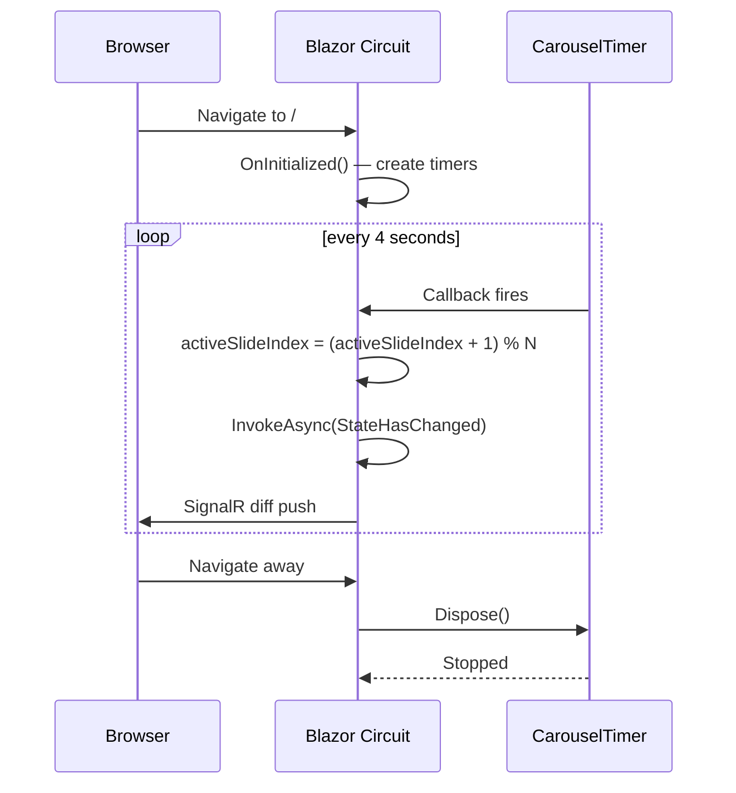

# Design Document — Homepage Redesign

## Overview

This design covers the visual and interactive enhancements to the Sri Sai Protouch public homepage (`Home.razor` + `app.css`). The feature transforms a static, text-and-grid layout into a dynamic, wellness-forward landing page without introducing any new back-end services, database queries, or external JavaScript libraries.

All changes are contained within two files:
- **`ClinicApp/Components/Pages/Home.razor`** — Blazor Server component, upgraded to `@rendermode InteractiveServer` to support in-process timers.
- **`ClinicApp/wwwroot/app.css`** — stylesheet, all new rules scoped under `.wellness-page` to protect admin/dashboard styles.

The six feature areas are:
1. **Auto-rotating image carousel** replacing the static gallery grid.
2. **Service card detail expansion** with toggleable in-page panels.
3. **Hero image sub-carousel** replacing the single static hero photo.
4. **Light green-accented color palette** update.
5. **Enhanced typography** with Playfair Display headings.
6. **Navigation bar color enhancements**.

---

## Architecture

### Component Model

```mermaid
graph TD
    A[Home.razor<br/>@rendermode InteractiveServer] --> B[CarouselTimer<br/>System.Threading.Timer]
    A --> C[HeroTimer<br/>System.Threading.Timer]
    A --> D[expandedService<br/>string? state field]
    A --> E[activeSlideIndex<br/>int state field]
    A --> F[activeHeroIndex<br/>int state field]
    B -->|"every 4s → StateHasChanged()"| E
    C -->|"every 5s → StateHasChanged()"| F
    A -->|IDisposable| G[Dispose()<br/>timers stopped]
```

### Timer Lifecycle

Both `System.Threading.Timer` instances are created in `OnInitialized()` and disposed in `Dispose()`. The component implements `IDisposable` via `@implements IDisposable` at the top of the Razor file. Timer callbacks always capture `this` by reference and must guard against post-disposal calls by wrapping the body in a try/catch that ignores `ObjectDisposedException`.



### CSS Architecture

All new styles are added under the `.wellness-page` scope. No global selectors are modified.

```
app.css
├── :root variables            (unchanged)
├── .glass-panel, .btn-clinic  (unchanged, admin)
├── .wellness-page             ← all public page rules live here
│   ├── .wellness-header       ← Nav enhancements (Req 6)
│   ├── .wellness-hero         ← Hero sub-carousel (Req 3)
│   ├── .carousel-section      ← NEW: main carousel (Req 1)
│   ├── .service-grid-v2       ← unchanged article styles
│   ├── .service-detail-panel  ← NEW: expandable panels (Req 2)
│   ├── .guarantee-strip       ← colour update (Req 4)
│   └── typography overrides   ← Playfair Display etc. (Req 5)
└── @media breakpoints         (extended as needed)
```

---

## Components and Interfaces

### 1. Main Carousel

**HTML Structure:**
```html
<section id="gallery" class="carousel-section">
  <div class="carousel-track">
    @foreach (var (slide, i) in carouselSlides.Select((s, i) => (s, i)))
    {
      <div class="carousel-slide @(i == activeSlideIndex ? "active" : "")">
        
        @if (!string.IsNullOrEmpty(slide.Caption))
        {
          <div class="carousel-caption">@slide.Caption</div>
        }
      </div>
    }
  </div>
  <div class="carousel-dots">
    @for (int i = 0; i < carouselSlides.Count; i++)
    {
      int idx = i;
      <button class="carousel-dot @(idx == activeSlideIndex ? "active" : "")"
              @onclick="() => JumpToSlide(idx)"
              aria-label="Go to slide @(idx + 1)"></button>
    }
  </div>
</section>
```

**C# State:**
```csharp
private List<CarouselSlide> carouselSlides = new();
private int activeSlideIndex = 0;
private System.Threading.Timer? _carouselTimer;
```

**`JumpToSlide(int idx)`:** Sets `activeSlideIndex = idx`, disposes old timer, creates new timer to reset the 4-second interval.

### 2. Hero Sub-Carousel

The `div.hero-photo` becomes a container for the sub-carousel. The same CSS fade mechanism is used, driven by `activeHeroIndex` and `_heroTimer`.

```html
<div class="hero-photo">
  @foreach (var (img, i) in heroImages.Select((s, i) => (s, i)))
  {
    
  }
  <div class="hero-badge">...</div>
</div>
```

**C# State:**
```csharp
private List<string> heroImages = new()
{
    "/images/clinic-gallery/gallery-05.jpeg",
    "/images/clinic-gallery/gallery-12.jpeg",
    "/images/clinic-gallery/gallery-23.jpeg",
    "/images/clinic-gallery/gallery-34.jpeg",
    "/images/clinic-gallery/hero-treatment.jpeg"
};
private int activeHeroIndex = 0;
private System.Threading.Timer? _heroTimer;
```

### 3. Service Detail Panels

Each service `<article>` becomes a `<button>` wrapped card. The detail panel is rendered immediately below as a conditionally-visible `<div>`.

```html
<div class="service-grid-v2">
  @foreach (var svc in serviceDefinitions)
  {
    <div>
      <button class="service-article @(expandedService == svc.Id ? "expanded" : "")"
              @onclick="() => ToggleService(svc.Id)"
              aria-expanded="@(expandedService == svc.Id)">
        <span>@svc.Number</span>
        <h3>@svc.Name</h3>
        <p>@svc.Summary</p>
        <ul>@foreach (var b in svc.Bullets) { <li>@b</li> }</ul>
      </button>
      <div class="service-detail-panel @(expandedService == svc.Id ? "open" : "")">
        <!-- detail content, thumbnail, Book Now link -->
      </div>
    </div>
  }
</div>
```

**`ToggleService(string id)`:** Sets `expandedService = (expandedService == id) ? null : id`.

### 4. Navigation Bar (CSS-only changes)

The `.wellness-header` gains:
- `background: #ffffff`
- `box-shadow: 0 2px 12px rgba(0,0,0,0.07)`

Navigation links gain hover color `#008d36` and `border-bottom: 2px solid #008d36`.

---

## Data Models

### `CarouselSlide` Record

```csharp
private record CarouselSlide(string ImagePath, string Caption);
```

| Field | Type | Description |
|---|---|---|
| `ImagePath` | `string` | Relative URL, e.g. `/images/clinic-gallery/gallery-05.jpeg` |
| `Caption` | `string` | Service category label shown as overlay. May be empty (""). |

### `ServiceDefinition` Record

```csharp
private record ServiceDefinition(
    string Id,
    string Number,
    string Name,
    string Summary,
    string[] Bullets,
    ServiceDetail Detail
);

private record ServiceDetail(
    string ThumbnailPath,
    string[] Treatments,
    string[] Outcomes,
    string[] SubServices
);
```

| Field | Description |
|---|---|
| `Id` | Stable key for `expandedService` comparison (e.g. `"weight-loss"`) |
| `Number` | Display number string `"01"` through `"04"` |
| `Name` | Service heading |
| `Summary` | Short paragraph for the card |
| `Bullets` | 2 bullet points shown on the card |
| `Detail.ThumbnailPath` | Single gallery image shown in the expanded panel |
| `Detail.Treatments` | List of treatment names for the panel |
| `Detail.Outcomes` | Key outcomes / metrics |
| `Detail.SubServices` | Sub-service names |

### Static Carousel Slide List (12 curated slides)

| Index | ImagePath | Caption |
|---|---|---|
| 0 | `gallery-07.jpeg` | Weight Loss & Slimming |
| 1 | `gallery-14.jpeg` | Physiotherapy & Rehabilitation |
| 2 | `gallery-21.jpeg` | Yoga & Holistic Wellness |
| 3 | `gallery-38.jpeg` | Specialised Programs |
| 4 | `gallery-03.jpeg` | Weight Loss & Slimming |
| 5 | `gallery-19.jpeg` | Physiotherapy & Rehabilitation |
| 6 | `gallery-28.jpeg` | Yoga & Holistic Wellness |
| 7 | `gallery-45.jpeg` | Specialised Programs |
| 8 | `gallery-11.jpeg` | Weight Loss & Slimming |
| 9 | `gallery-32.jpeg` | Physiotherapy & Rehabilitation |
| 10 | `gallery-50.jpeg` | Yoga & Holistic Wellness |
| 11 | `gallery-58.jpeg` | Specialised Programs |

> **Rationale:** 12 slides, 3 per category, interleaved rather than grouped — so sequential auto-rotation always alternates between service areas. The order is curated (not gallery-01 through gallery-60) as required by Requirement 7.5.

### `@code {}` Block State Summary

| Field | Type | Default | Description |
|---|---|---|---|
| `carouselSlides` | `List<CarouselSlide>` | 12 entries | Main carousel slide data |
| `activeSlideIndex` | `int` | `0` | Currently displayed carousel slide |
| `_carouselTimer` | `Timer?` | `null` | 4-second auto-advance timer |
| `heroImages` | `List<string>` | 5 entries | Hero sub-carousel image paths |
| `activeHeroIndex` | `int` | `0` | Currently displayed hero image |
| `_heroTimer` | `Timer?` | `null` | 5-second hero advance timer |
| `expandedService` | `string?` | `null` | Id of currently expanded service (null = none) |
| `serviceDefinitions` | `List<ServiceDefinition>` | 4 entries | Static service data (card + detail content) |
| `guarantees` | `string[]` | 5 entries | Guarantee strip labels (unchanged) |

---

## Correctness Properties

*A property is a characteristic or behavior that should hold true across all valid executions of a system — essentially, a formal statement about what the system should do. Properties serve as the bridge between human-readable specifications and machine-verifiable correctness guarantees.*

### Property 1: Slide Index Advancement Wraps

*For any* carousel slide list of length N ≥ 1 and any current active slide index in the range [0, N-1], when the carousel timer fires, the new active slide index SHALL equal `(previousIndex + 1) % N`.

**Validates: Requirements 1.5**

### Property 2: Dot Indicator Count Matches Slides

*For any* carousel slide list of length N, the number of rendered dot indicator elements SHALL equal N, and exactly one dot indicator SHALL have the `active` CSS class — the one at position `activeSlideIndex`.

**Validates: Requirements 1.6**

### Property 3: Caption Overlay Conditional Rendering

*For any* `CarouselSlide`, if `Caption` is a non-empty string, the rendered carousel slide element SHALL contain an overlay element whose text content equals that `Caption`. If `Caption` is an empty string, no caption overlay element SHALL appear in the rendered slide.

**Validates: Requirements 1.11, 7.6**

### Property 4: Service Panel Toggle Idempotence

*For any* service ID in the `serviceDefinitions` list, calling `ToggleService(id)` twice in sequence (with no other state changes between calls) SHALL result in `expandedService` being `null` — i.e., toggling open then closed returns to the default collapsed state.

**Validates: Requirements 2.3**

### Property 5: Service Panel Exclusive Expansion

*For any* two distinct service IDs A and B in the `serviceDefinitions` list, if `expandedService == A` and `ToggleService(B)` is called, then `expandedService` SHALL equal B and SHALL NOT equal A — only one panel can be open at a time.

**Validates: Requirements 2.4**

### Property 6: Service Detail Panel Contains Gallery Thumbnail

*For any* expanded `ServiceDefinition` in the `serviceDefinitions` list, the rendered `service-detail-panel` SHALL contain exactly one `` element whose `src` attribute is a path from the Gallery_Images set (i.e., begins with `/images/clinic-gallery/`).

**Validates: Requirements 7.4**

---

## Error Handling

### Timer Disposal Race Condition

**Scenario:** The Blazor circuit is torn down while a timer callback is in-flight.

**Handling:** Each timer callback wraps its body in:
```csharp
try {
    activeSlideIndex = (activeSlideIndex + 1) % carouselSlides.Count;
    await InvokeAsync(StateHasChanged);
} catch (ObjectDisposedException) { /* circuit gone — ignore */ }
  catch (Exception) { /* swallow all non-fatal errors in timer callbacks */ }
```

`Dispose()` calls `_carouselTimer?.Dispose()` and `_heroTimer?.Dispose()` wrapped in a try/catch.

### Hero Image Load Failures

**Scenario:** A gallery image returns a 404 or fails to load in the hero sub-carousel.

**Handling:** Each `` in the hero sub-carousel carries:
```html
onerror="this.style.display='none'; this.parentElement.classList.add('hero-fallback')"
```

The `.hero-photo.hero-fallback` CSS rule applies:
```css
.wellness-page .hero-photo.hero-fallback {
    background: linear-gradient(135deg, #008d36 0%, #ffffff 100%);
    min-height: 460px;
}
```
This ensures no broken image icons are shown; the section gracefully falls back to a brand-green gradient.

### Carousel Image Load Failures

**Scenario:** A gallery image in the main carousel fails to load.

**Handling:** Each carousel slide `` carries `onerror="this.style.opacity='0'"`. The slide container retains its height (enforced by `aspect-ratio: 16/9` CSS) so the dot indicators remain stable. The timer continues advancing normally.

### Empty Slide List Guard

**Scenario:** `carouselSlides` is empty (e.g., future refactor removes static initializer).

**Handling:** The timer callback guards with:
```csharp
if (carouselSlides.Count == 0) return;
```
The carousel section also conditionally renders: `@if (carouselSlides.Count > 0)`.

### Dot Click Outside Range

**Scenario:** A `JumpToSlide(idx)` call with an out-of-range `idx` (defensive guard for future dynamic data).

**Handling:**
```csharp
private void JumpToSlide(int idx)
{
    if (idx < 0 || idx >= carouselSlides.Count) return;
    activeSlideIndex = idx;
    _carouselTimer?.Dispose();
    _carouselTimer = new Timer(_ => AdvanceSlide(), null,
        TimeSpan.FromSeconds(4), TimeSpan.FromSeconds(4));
}
```

---

## Testing Strategy

### Overview

This feature is a pure front-end UI change: CSS visual updates, Blazor component state management, and static data initialization. PBT is appropriate for the pure logic functions (index arithmetic, toggle state, conditional rendering rules). CSS, layout, and integration rendering are better covered by example-based Blazor component tests and visual inspection.

**Testing stack:**
- **Unit / component tests:** bUnit (Blazor component testing library for .NET)
- **Property-based tests:** FsCheck (integrates with xUnit; works with bUnit render results)
- **Visual / responsive tests:** Manual browser inspection at breakpoints (768px, 850px, 320px)

---

### Property-Based Tests

Each property below maps to a Correctness Property above. Minimum **100 iterations** per test.

#### PBT-1: Slide Index Advancement Wraps

```
Tag: Feature: homepage-redesign, Property 1: Slide Index Advancement Wraps
```

Generator: Produce a random `listLength` in [1, 60] and a random `startIndex` in [0, listLength-1].  
Call the advancement logic: `newIndex = (startIndex + 1) % listLength`.  
Assert: `newIndex >= 0 && newIndex < listLength`.  
Assert: When `startIndex == listLength - 1`, `newIndex == 0` (wrap-around).

**Validates: Property 1 / Requirements 1.5**

---

#### PBT-2: Dot Indicator Count Matches Slides

```
Tag: Feature: homepage-redesign, Property 2: Dot Indicator Count Matches Slides
```

Generator: Produce a `List<CarouselSlide>` of random length N in [1, 30] with arbitrary `ImagePath` and `Caption` strings.  
Render `Home` component with this list injected.  
Assert: The number of `.carousel-dot` elements == N.  
Assert: Exactly one `.carousel-dot.active` element exists.  
Assert: The active dot is at position `activeSlideIndex`.

**Validates: Property 2 / Requirements 1.6**

---

#### PBT-3: Caption Overlay Conditional Rendering

```
Tag: Feature: homepage-redesign, Property 3: Caption Overlay Conditional Rendering
```

Generator: Produce a `CarouselSlide` with a randomly chosen `Caption` (50% chance empty string, 50% chance random non-empty string of 1–60 chars).  
Render a minimal carousel containing only this slide (set `activeSlideIndex = 0`).  
If `Caption` is non-empty: assert `.carousel-caption` element exists and its text equals `Caption`.  
If `Caption` is empty: assert no `.carousel-caption` element exists in the rendered slide.

**Validates: Property 3 / Requirements 1.11, 7.6**

---

#### PBT-4: Service Panel Toggle Idempotence

```
Tag: Feature: homepage-redesign, Property 4: Service Panel Toggle Idempotence
```

Generator: Pick a random `serviceId` from the 4 known service IDs (`"weight-loss"`, `"physio"`, `"yoga"`, `"specialised"`).  
Start with `expandedService = null`.  
Call `ToggleService(serviceId)` — assert `expandedService == serviceId`.  
Call `ToggleService(serviceId)` again — assert `expandedService == null`.

**Validates: Property 4 / Requirements 2.3**

---

#### PBT-5: Service Panel Exclusive Expansion

```
Tag: Feature: homepage-redesign, Property 5: Service Panel Exclusive Expansion
```

Generator: Pick two distinct service IDs A and B (randomly from the 4 known IDs, where A ≠ B).  
Set `expandedService = A`. Call `ToggleService(B)`.  
Assert: `expandedService == B`.  
Assert: `expandedService != A`.

**Validates: Property 5 / Requirements 2.4**

---

#### PBT-6: Service Detail Panel Contains Gallery Thumbnail

```
Tag: Feature: homepage-redesign, Property 6: Service Detail Panel Contains Gallery Thumbnail
```

Generator: Pick a random `ServiceDefinition` from the 4 defined services.  
Render the component with `expandedService = svc.Id`.  
Find the `.service-detail-panel.open img` elements.  
Assert: Exactly one `` exists in the open panel.  
Assert: Its `src` attribute starts with `/images/clinic-gallery/`.

**Validates: Property 6 / Requirements 7.4**

---

### Example-Based Unit Tests

These cover specific scenarios and static content verification.

| Test | What it Verifies | Requirement |
|---|---|---|
| `CarouselStartsOnFirstSlide` | `activeSlideIndex == 0` on init | 1.1 |
| `CarouselHasMinimum12Slides` | `carouselSlides.Count >= 12` | 1.4 |
| `CarouselCoversAllFourCategories` | All 4 category strings appear in captions | 1.4 |
| `DotClickJumpsToSlide` | `JumpToSlide(3)` sets `activeSlideIndex = 3` | 1.7 |
| `HeroHas3to5Images` | `heroImages.Count` in [3, 5] | 3.2 |
| `HeroFallbackOnImageError` | `onerror` adds `hero-fallback` class | 3.4 |
| `HeroPreservesAllCTAs` | All 3 CTAs + ISO mark present in markup | 3.6 |
| `WeightLossDetailContent` | LPG, RF therapy, body wraps, cryotherapy present | 2.6 |
| `PhysioDetailContent` | Back pain, TENS, orthopaedic present | 2.7 |
| `YogaDetailContent` | Diabetes, menstrual wellness, pre-natal present | 2.8 |
| `SpecialisedDetailContent` | Height increase, up to 23 years, sports rehab | 2.9 |
| `ExpandedPanelDefaultIsNull` | `expandedService == null` on init | 2.2 |
| `GalleryGridRemoved` | No `gallery-grid` class in rendered output | 7.1 |
| `CarouselSlidesNotSequential` | First 5 slides are not `gallery-01` through `gallery-05` | 7.5 |
| `IDisposableImplemented` | Component implements `IDisposable` | 1.10, 7.7 |

### Smoke / Structural Checks (Code Review / Static Analysis)

| Check | Requirement |
|---|---|
| `System.Threading.Timer` used in `@code {}`, not `System.Timers.Timer` | 1.3 |
| `@implements IDisposable` declared at top of file | 1.10 |
| All new CSS selectors scoped under `.wellness-page` | 4.7, 5.8, 6.7 |
| `.wellness-header` CSS separated from `.navbar-clinic` (admin nav) | 6.7 |
| `galleryImages` field removed from `@code {}` | 7.6 |
| `carouselSlides` typed as `List<CarouselSlide>` | 7.6 |
| All timer instances disposed in `Dispose()` | 7.7 |

### Responsive / Visual Testing

| Test | Viewport | Requirement |
|---|---|---|
| Carousel 16:9 aspect ratio, no overflow | 768px | 1.9 |
| Hero stacks to single column, image 280px height | 850px | 3.5 |
| Service detail panels no horizontal overflow | 320px | 2.10 |
| Nav hides link list, shows logo + call button only | 850px | 6.5 |
| Guarantee strip green background, white text legible | All | 4.2 |
| Body text on `#f5f9f6` background — WCAG 4.5:1 contrast | All | 4.8 |
